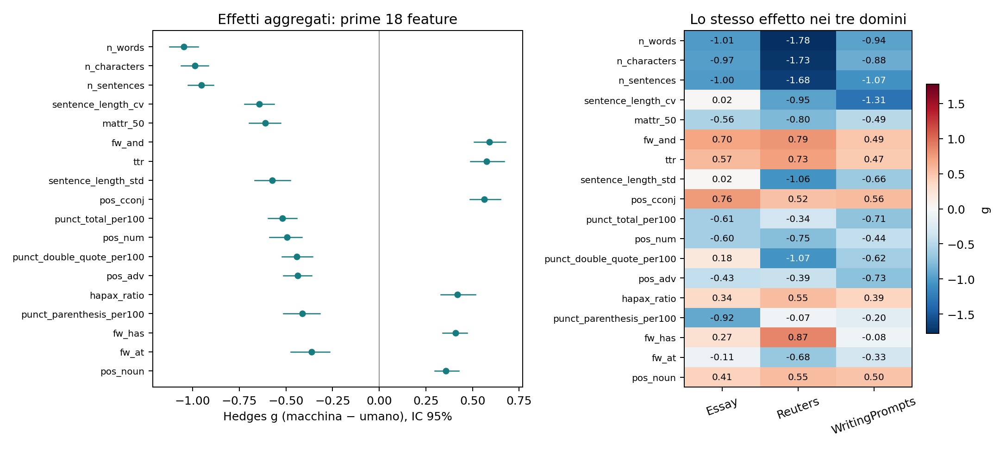
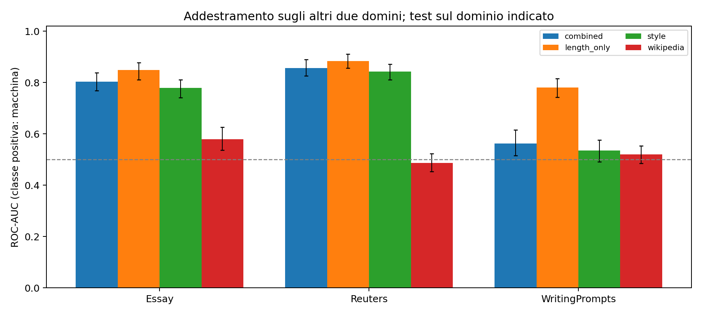

# Esperimento esplorativo: componente stilometrica

> Aggiornamento successivo: i tre CSV forniti dall’autore come scaricati da Google Drive sono identici byte per byte ai file usati; vedere il [confronto di provenienza](../../../docs/provenance/mgtbench_drive_comparison.md). Gli avvisi sottostanti descrivono lo stato della verifica al momento del run; i risultati e i manifest non sono stati ricalcolati.

## Dati e provenienza

Testi analizzati: 1800; coppie di origine: 900. Etichetta 0 = umano, 1 = macchina. Ogni umano compare una volta nel campione principale.

La provenienza completa, gli hash SHA-256 e i conteggi di esclusione sono in `data_manifest.json`. Il campione usa la baseline MGTBench, senza attacchi o riscritture. Non è una riproduzione dei file di attacco chiamati `clean` in TH-Bench.

**Fonte effettiva:** https://github.com/derek33125/AITextDetection. L’identità dei byte con la distribuzione ufficiale non è stata verificata quando si usa il mirror.

**Pulizia applicata:** Pinned TH-Bench process_spaces spacing repair; Symmetric trailing-fragment removal to last plausible sentence-end punctuation before minimum length; Symmetric minimum whitespace-word count after tail handling; Global casefolded whitespace-normalized exact text deduplication; Machines identical to any source human excluded; No attack/humanization or fixed-word truncation; No phrase/markup/refusal stripping: these remain measurable and potentially confounding.

| domain | generator | label | n |
| --- | --- | --- | --- |
| Essay | ChatGLM | 1 | 43 |
| Essay | ChatGPT | 1 | 43 |
| Essay | ChatGPT-turbo | 1 | 43 |
| Essay | Claude | 1 | 43 |
| Essay | Dolly | 1 | 43 |
| Essay | GPT4All | 1 | 43 |
| Essay | StableLM | 1 | 42 |
| Essay | human | 0 | 300 |
| Reuters | ChatGLM | 1 | 43 |
| Reuters | ChatGPT | 1 | 43 |
| Reuters | ChatGPT-turbo | 1 | 43 |
| Reuters | Claude | 1 | 43 |
| Reuters | Dolly | 1 | 43 |
| Reuters | GPT4All | 1 | 43 |
| Reuters | StableLM | 1 | 42 |
| Reuters | human | 0 | 300 |
| WritingPrompts | ChatGLM | 1 | 43 |
| WritingPrompts | ChatGPT | 1 | 43 |
| WritingPrompts | ChatGPT-turbo | 1 | 43 |
| WritingPrompts | Claude | 1 | 43 |
| WritingPrompts | Dolly | 1 | 43 |
| WritingPrompts | GPT4All | 1 | 43 |
| WritingPrompts | StableLM | 1 | 42 |
| WritingPrompts | human | 0 | 300 |

## Protocollo

Feature fissate prima di osservare i risultati: spaCy en_core_web_sm 3.8.0, textstat en_US e MATTR con finestra 50. Le definizioni e i denominatori sono in `feature_schema.json`. Non si usano troncamenti a un numero fisso di parole; il manifest documenta l’eventuale rimozione simmetrica delle code senza terminazione di frase plausibile. TTR, hapax e conteggi globali sono diagnostici esclusi dal modello principale di stile.

Effetti: Hedges g corretto per piccoli campioni, con segno macchina meno umano; g positivo indica valori maggiori nei testi macchina. IC 95% bootstrap a gruppi di origine; p-value paired t sulle differenze entro coppia e correzione BH separata entro ogni tabella. Per generatore si confrontano soltanto gli umani delle corrispondenti coppie. Le soglie di grandezza dell’effetto sono euristiche, non confini naturali.

Classificatore: regressione logistica L2, C=1 fisso, class_weight=balanced, soglia 0.5; imputazione mediana e standardizzazione stimate esclusivamente sul training. CV a cinque fold con gruppi di origine disgiunti entro dominio; leave-one-domain-out; leave-one-generator-out con ulteriore esclusione dal training dei gruppi sorgente nel test. Nessun tuning sul test. Le metriche usano predizioni out-of-fold aggregate. Gli IC delle metriche ricampionano le predizioni fisse per gruppo: non includono tutta l’incertezza dell’addestramento.

## Feature con i maggiori effetti aggregati

| feature | human_mean | machine_mean | hedges_g | ci_low | ci_high | bh_q |
| --- | --- | --- | --- | --- | --- | --- |
| n_words | 535.801 | 252.621 | -1.047 | -1.124 | -0.971 | 1.03e-90 |
| n_characters | 3270.422 | 1570.492 | -0.988 | -1.063 | -0.914 | 9.64e-84 |
| n_sentences | 30.886 | 13.787 | -0.952 | -1.025 | -0.889 | 2.47e-84 |
| sentence_length_cv | 0.441 | 0.341 | -0.643 | -0.722 | -0.562 | 5.90e-50 |
| mattr_50 | 0.809 | 0.782 | -0.612 | -0.697 | -0.528 | 5.71e-36 |
| fw_and | 0.026 | 0.035 | 0.589 | 0.508 | 0.678 | 8.47e-39 |
| ttr | 0.505 | 0.552 | 0.576 | 0.488 | 0.669 | 1.27e-35 |
| sentence_length_std | 7.867 | 6.428 | -0.574 | -0.667 | -0.476 | 2.14e-31 |
| pos_cconj | 0.032 | 0.041 | 0.562 | 0.485 | 0.649 | 1.02e-35 |
| punct_total_per100 | 16.297 | 13.485 | -0.518 | -0.595 | -0.442 | 2.22e-29 |
| pos_num | 0.022 | 0.012 | -0.495 | -0.588 | -0.415 | 2.52e-33 |
| punct_double_quote_per100 | 2.013 | 0.951 | -0.442 | -0.520 | -0.359 | 3.06e-21 |
| pos_adv | 0.042 | 0.034 | -0.436 | -0.513 | -0.363 | 3.10e-26 |
| hapax_ratio | 0.357 | 0.392 | 0.418 | 0.331 | 0.515 | 8.44e-20 |
| punct_parenthesis_per100 | 0.806 | 0.340 | -0.411 | -0.513 | -0.317 | 6.60e-20 |
| fw_has | 0.003 | 0.005 | 0.408 | 0.338 | 0.471 | 6.74e-19 |
| fw_at | 0.005 | 0.003 | -0.363 | -0.473 | -0.266 | 1.26e-13 |
| pos_noun | 0.223 | 0.242 | 0.357 | 0.297 | 0.427 | 1.70e-23 |

Gli effetti aggregati non dimostrano robustezza: consultare `feature_effects.csv` per tutti i domini, generatori e incroci dominio×generatore.

## Classificazione e trasferimento

| protocol | domain | generator | feature_set | n_test | roc_auc | roc_auc_ci_low | roc_auc_ci_high | balanced_accuracy | macro_f1 |
| --- | --- | --- | --- | --- | --- | --- | --- | --- | --- |
| leave_domain_out | Essay | ALL | combined | 600 | 0.803 | 0.768 | 0.839 | 0.555 | 0.464 |
| leave_domain_out | Essay | ALL | length_only | 600 | 0.849 | 0.811 | 0.878 | 0.655 | 0.652 |
| leave_domain_out | Essay | ALL | style | 600 | 0.779 | 0.741 | 0.811 | 0.550 | 0.454 |
| leave_domain_out | Essay | ALL | wikipedia | 600 | 0.580 | 0.537 | 0.626 | 0.522 | 0.518 |
| leave_domain_out | Reuters | ALL | combined | 600 | 0.856 | 0.826 | 0.890 | 0.783 | 0.782 |
| leave_domain_out | Reuters | ALL | length_only | 600 | 0.884 | 0.857 | 0.911 | 0.775 | 0.773 |
| leave_domain_out | Reuters | ALL | style | 600 | 0.843 | 0.811 | 0.872 | 0.773 | 0.773 |
| leave_domain_out | Reuters | ALL | wikipedia | 600 | 0.487 | 0.453 | 0.524 | 0.555 | 0.487 |
| leave_domain_out | WritingPrompts | ALL | combined | 600 | 0.563 | 0.516 | 0.616 | 0.538 | 0.535 |
| leave_domain_out | WritingPrompts | ALL | length_only | 600 | 0.780 | 0.744 | 0.816 | 0.737 | 0.736 |
| leave_domain_out | WritingPrompts | ALL | style | 600 | 0.535 | 0.491 | 0.577 | 0.527 | 0.523 |
| leave_domain_out | WritingPrompts | ALL | wikipedia | 600 | 0.520 | 0.485 | 0.553 | 0.513 | 0.428 |
| leave_generator_out | ALL | ChatGLM | combined | 258 | 0.980 | 0.964 | 0.992 | 0.922 | 0.922 |
| leave_generator_out | ALL | ChatGLM | length_only | 258 | 0.976 | 0.948 | 0.995 | 0.833 | 0.829 |
| leave_generator_out | ALL | ChatGLM | style | 258 | 0.981 | 0.968 | 0.993 | 0.926 | 0.926 |
| leave_generator_out | ALL | ChatGLM | wikipedia | 258 | 0.511 | 0.439 | 0.567 | 0.477 | 0.406 |
| leave_generator_out | ALL | ChatGPT | combined | 258 | 0.950 | 0.922 | 0.974 | 0.888 | 0.888 |
| leave_generator_out | ALL | ChatGPT | length_only | 258 | 0.967 | 0.937 | 0.990 | 0.833 | 0.829 |
| leave_generator_out | ALL | ChatGPT | style | 258 | 0.951 | 0.929 | 0.975 | 0.899 | 0.899 |
| leave_generator_out | ALL | ChatGPT | wikipedia | 258 | 0.395 | 0.335 | 0.455 | 0.457 | 0.400 |
| leave_generator_out | ALL | ChatGPT-turbo | combined | 258 | 0.904 | 0.864 | 0.942 | 0.841 | 0.841 |
| leave_generator_out | ALL | ChatGPT-turbo | length_only | 258 | 0.443 | 0.390 | 0.496 | 0.453 | 0.387 |
| leave_generator_out | ALL | ChatGPT-turbo | style | 258 | 0.887 | 0.845 | 0.926 | 0.818 | 0.818 |
| leave_generator_out | ALL | ChatGPT-turbo | wikipedia | 258 | 0.779 | 0.722 | 0.834 | 0.767 | 0.765 |
| leave_generator_out | ALL | Claude | combined | 258 | 0.727 | 0.671 | 0.781 | 0.647 | 0.628 |
| leave_generator_out | ALL | Claude | length_only | 258 | 0.559 | 0.479 | 0.631 | 0.453 | 0.409 |
| leave_generator_out | ALL | Claude | style | 258 | 0.712 | 0.644 | 0.766 | 0.640 | 0.618 |
| leave_generator_out | ALL | Claude | wikipedia | 258 | 0.649 | 0.594 | 0.700 | 0.581 | 0.548 |
| leave_generator_out | ALL | Dolly | combined | 258 | 0.846 | 0.796 | 0.892 | 0.791 | 0.790 |
| leave_generator_out | ALL | Dolly | length_only | 258 | 0.980 | 0.961 | 0.994 | 0.833 | 0.829 |
| leave_generator_out | ALL | Dolly | style | 258 | 0.843 | 0.794 | 0.893 | 0.795 | 0.794 |
| leave_generator_out | ALL | Dolly | wikipedia | 258 | 0.347 | 0.288 | 0.406 | 0.465 | 0.356 |
| leave_generator_out | ALL | GPT4All | combined | 258 | 0.955 | 0.929 | 0.976 | 0.895 | 0.895 |
| leave_generator_out | ALL | GPT4All | length_only | 258 | 0.942 | 0.909 | 0.968 | 0.818 | 0.812 |
| leave_generator_out | ALL | GPT4All | style | 258 | 0.960 | 0.937 | 0.981 | 0.903 | 0.903 |
| leave_generator_out | ALL | GPT4All | wikipedia | 258 | 0.531 | 0.463 | 0.594 | 0.508 | 0.467 |
| leave_generator_out | ALL | StableLM | combined | 252 | 0.676 | 0.606 | 0.736 | 0.623 | 0.604 |
| leave_generator_out | ALL | StableLM | length_only | 252 | 0.940 | 0.908 | 0.968 | 0.845 | 0.841 |
| leave_generator_out | ALL | StableLM | style | 252 | 0.663 | 0.598 | 0.728 | 0.631 | 0.610 |
| leave_generator_out | ALL | StableLM | wikipedia | 252 | 0.412 | 0.341 | 0.483 | 0.440 | 0.333 |
| within_domain | Essay | ALL | combined | 600 | 0.916 | 0.893 | 0.939 | 0.858 | 0.858 |
| within_domain | Essay | ALL | length_only | 600 | 0.847 | 0.813 | 0.876 | 0.657 | 0.654 |
| within_domain | Essay | ALL | style | 600 | 0.922 | 0.897 | 0.945 | 0.863 | 0.863 |
| within_domain | Essay | ALL | wikipedia | 600 | 0.552 | 0.510 | 0.601 | 0.590 | 0.581 |
| within_domain | Reuters | ALL | combined | 600 | 0.947 | 0.928 | 0.964 | 0.890 | 0.890 |
| within_domain | Reuters | ALL | length_only | 600 | 0.878 | 0.845 | 0.906 | 0.802 | 0.801 |
| within_domain | Reuters | ALL | style | 600 | 0.943 | 0.923 | 0.962 | 0.875 | 0.875 |
| within_domain | Reuters | ALL | wikipedia | 600 | 0.633 | 0.599 | 0.671 | 0.575 | 0.507 |
| within_domain | WritingPrompts | ALL | combined | 600 | 0.879 | 0.849 | 0.906 | 0.823 | 0.823 |
| within_domain | WritingPrompts | ALL | length_only | 600 | 0.812 | 0.776 | 0.842 | 0.727 | 0.725 |
| within_domain | WritingPrompts | ALL | style | 600 | 0.879 | 0.852 | 0.906 | 0.817 | 0.817 |
| within_domain | WritingPrompts | ALL | wikipedia | 600 | 0.577 | 0.537 | 0.617 | 0.528 | 0.491 |

## Lista corta esplorativa

Regola: stessa direzione in tutti e tre i domini, |g| ≥ 0.3 in ciascuno, segno coerente in almeno 5/7 dei generatori; massimo 12 feature; rimozione di ridondanze con |correlazione di Spearman| ≥ 0.85. La lista è ricavata dall’intero campione ed è una proposta per esperimenti successivi: non è stata retroattivamente valutata come se fosse una scelta indipendente dal test.

| feature | pooled_g | min_domain_abs_g | generators_passing | n_generators |
| --- | --- | --- | --- | --- |
| fw_and | 0.589 | 0.489 | 7 | 7 |
| punct_total_per100 | -0.518 | 0.345 | 7 | 7 |
| pos_num | -0.495 | 0.444 | 7 | 7 |
| flesch_kincaid_grade | 0.304 | 0.306 | 6 | 7 |
| pos_adv | -0.436 | 0.391 | 7 | 7 |
| pos_noun | 0.357 | 0.408 | 6 | 7 |
| mattr_50 | -0.612 | 0.491 | 5 | 7 |

## Cosa si può concludere sulla guida Wikipedia

Il modello `wikipedia` usa soltanto i proxy fissati nel codice: vocabolario AI, enfasi, conclusioni, formule conversazionali, parallelismi negativi, Markdown ed em dash. Non misura l’intera guida, né verifica superficialità, neutralità, correttezza delle fonti o intenzione dell’autore. Confrontare `wikipedia` con `style` e `combined` su dati non visti; un vantaggio solo nel dominio di addestramento non dimostra trasferibilità. Gli indicatori possono essere rari, dipendere dall’epoca dei generatori e cambiare segno.

## Limiti

- Circa 42–43 testi macchina per generatore e dominio: le stime fini hanno incertezza elevata.
- Le feature normalizzate possono ancora dipendere dalla lunghezza; `length_only` è un controllo, non elimina ogni confondente.
- I generatori MGTBench sono storici: risultati non generalizzabili automaticamente agli LLM attuali o a testi umanizzati.
- La lista corta richiede conferma indipendente, idealmente su un nuovo campione e nuove riscritture.
- La pulizia delle terminazioni è euristica: non certifica la completezza grammaticale né identifica tutte le generazioni fallite. Rifiuti e formule di chatbot possono restare.
- Il mirror pubblico, se utilizzato, non è stato confrontato byte per byte con l’archivio originale Google Drive; vedere manifest.

File completi: `feature_effects.csv`, `feature_robustness.csv`, `classifier_metrics.csv`, `predictions.csv`, `run_metadata.json`, `feature_schema.json` e `data_manifest.json`.
