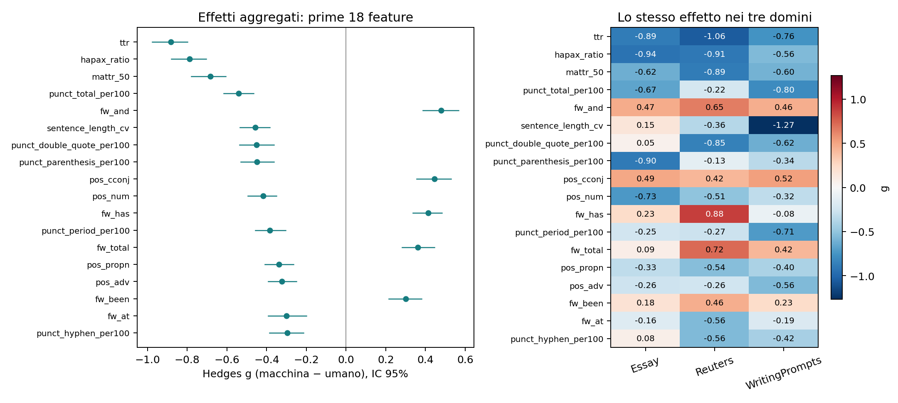
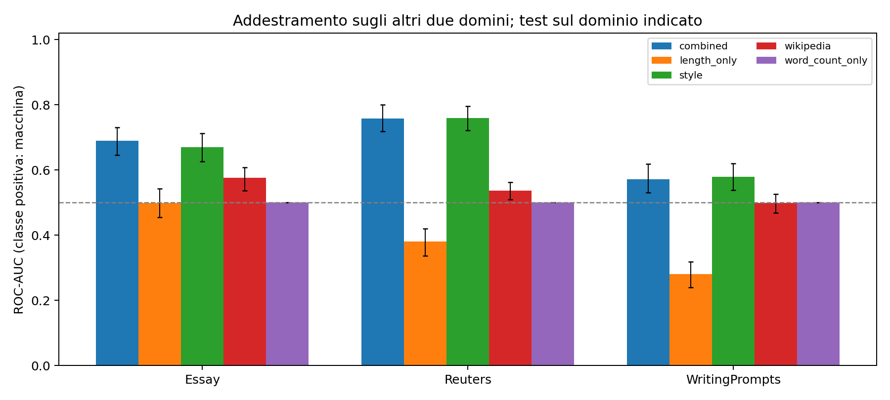

# Esperimento stilometrico con controllo esatto della lunghezza

> Aggiornamento successivo: i tre CSV forniti dall’autore come scaricati da Google Drive sono identici byte per byte ai file usati; vedere il [confronto di provenienza](../../../docs/provenance/mgtbench_drive_comparison.md). Gli avvisi sottostanti descrivono lo stato della verifica al momento del run; i risultati e i manifest non sono stati ricalcolati.

## Dati e provenienza

Testi analizzati: 1800; coppie di origine: 900. Etichetta 0 = umano, 1 = macchina. Ogni umano compare una volta nel campione principale.

La provenienza completa, gli hash SHA-256 e i conteggi di esclusione sono in `data_manifest.json`. Il campione usa la baseline MGTBench, senza attacchi o riscritture. Non è una riproduzione dei file di attacco chiamati `clean` in TH-Bench.

**Fonte effettiva:** https://github.com/derek33125/AITextDetection. L’identità dei byte con la distribuzione ufficiale non è stata verificata quando si usa il mirror.

**Pulizia applicata:** Pinned TH-Bench spacing normalization; Symmetric incomplete-tail removal; Initial sentence-ended prefixes with EXACT equal lexical count in each original human/machine pair; Global exact casefold/whitespace text deduplication; no arbitrary-word cuts or padding.

| domain | generator | label | n |
| --- | --- | --- | --- |
| Essay | ChatGLM | 1 | 43 |
| Essay | ChatGPT | 1 | 43 |
| Essay | ChatGPT-turbo | 1 | 43 |
| Essay | Claude | 1 | 43 |
| Essay | Dolly | 1 | 43 |
| Essay | GPT4All | 1 | 43 |
| Essay | StableLM | 1 | 42 |
| Essay | human | 0 | 300 |
| Reuters | ChatGLM | 1 | 43 |
| Reuters | ChatGPT | 1 | 43 |
| Reuters | ChatGPT-turbo | 1 | 43 |
| Reuters | Claude | 1 | 43 |
| Reuters | Dolly | 1 | 43 |
| Reuters | GPT4All | 1 | 43 |
| Reuters | StableLM | 1 | 42 |
| Reuters | human | 0 | 300 |
| WritingPrompts | ChatGLM | 1 | 43 |
| WritingPrompts | ChatGPT | 1 | 43 |
| WritingPrompts | ChatGPT-turbo | 1 | 43 |
| WritingPrompts | Claude | 1 | 43 |
| WritingPrompts | Dolly | 1 | 43 |
| WritingPrompts | GPT4All | 1 | 43 |
| WritingPrompts | StableLM | 1 | 42 |
| WritingPrompts | human | 0 | 300 |

## Protocollo

Feature fissate prima di osservare i risultati: spaCy en_core_web_sm 3.8.0, textstat en_US e MATTR con finestra 50. Le definizioni e i denominatori sono in `feature_schema.json`. Si conservano prefissi iniziali terminati con punteggiatura di frase, tra 90 e 180 parole lessicali, scegliendo conteggi ESATTAMENTE uguali nella coppia originale e vicini a 150. Non si taglia a metà parola o frase. Questo controllo riguarda brevi passaggi iniziali, non l’intero documento. TTR, hapax e conteggi globali sono diagnostici esclusi dal modello principale di stile.

Effetti: Hedges g corretto per piccoli campioni, con segno macchina meno umano; g positivo indica valori maggiori nei testi macchina. IC 95% bootstrap a gruppi di origine; p-value paired t sulle differenze entro coppia e correzione BH separata entro ogni tabella. Per generatore si confrontano soltanto gli umani delle corrispondenti coppie. Le soglie di grandezza dell’effetto sono euristiche, non confini naturali.

Classificatore: regressione logistica L2, C=1 fisso, class_weight=balanced, soglia 0.5; imputazione mediana e standardizzazione stimate esclusivamente sul training. CV a cinque fold con gruppi di origine disgiunti entro dominio; leave-one-domain-out; leave-one-generator-out con ulteriore esclusione dal training dei gruppi sorgente nel test. Nessun tuning sul test. Le metriche usano predizioni out-of-fold aggregate. Gli IC delle metriche ricampionano le predizioni fisse per gruppo: non includono tutta l’incertezza dell’addestramento.

## Feature con i maggiori effetti aggregati

| feature | human_mean | machine_mean | hedges_g | ci_low | ci_high | bh_q |
| --- | --- | --- | --- | --- | --- | --- |
| ttr | 0.654 | 0.601 | -0.883 | -0.976 | -0.799 | 9.44e-66 |
| hapax_ratio | 0.500 | 0.437 | -0.789 | -0.881 | -0.705 | 1.39e-52 |
| mattr_50 | 0.810 | 0.777 | -0.684 | -0.779 | -0.607 | 4.06e-42 |
| punct_total_per100 | 16.329 | 13.379 | -0.542 | -0.617 | -0.465 | 2.05e-31 |
| fw_and | 0.026 | 0.034 | 0.479 | 0.387 | 0.567 | 4.23e-26 |
| sentence_length_cv | 0.406 | 0.327 | -0.458 | -0.534 | -0.384 | 4.52e-25 |
| punct_double_quote_per100 | 1.906 | 0.864 | -0.452 | -0.538 | -0.363 | 3.20e-21 |
| punct_parenthesis_per100 | 0.906 | 0.333 | -0.448 | -0.531 | -0.364 | 2.80e-20 |
| pos_cconj | 0.032 | 0.039 | 0.444 | 0.355 | 0.528 | 2.24e-22 |
| pos_num | 0.024 | 0.014 | -0.417 | -0.494 | -0.351 | 1.81e-23 |
| fw_has | 0.003 | 0.006 | 0.414 | 0.337 | 0.484 | 3.81e-18 |
| punct_period_per100 | 6.707 | 5.730 | -0.383 | -0.458 | -0.305 | 1.35e-19 |
| fw_total | 0.376 | 0.396 | 0.362 | 0.282 | 0.446 | 3.10e-16 |
| pos_propn | 0.072 | 0.053 | -0.338 | -0.410 | -0.264 | 5.07e-19 |
| pos_adv | 0.039 | 0.033 | -0.322 | -0.392 | -0.251 | 6.11e-14 |
| fw_been | 0.002 | 0.003 | 0.301 | 0.215 | 0.380 | 2.72e-10 |
| fw_at | 0.004 | 0.003 | -0.300 | -0.392 | -0.201 | 1.10e-09 |
| punct_hyphen_per100 | 1.132 | 0.748 | -0.297 | -0.386 | -0.215 | 3.79e-10 |

Gli effetti aggregati non dimostrano robustezza: consultare `feature_effects.csv` per tutti i domini, generatori e incroci dominio×generatore.

## Classificazione e trasferimento

| protocol | domain | generator | feature_set | n_test | roc_auc | roc_auc_ci_low | roc_auc_ci_high | balanced_accuracy | macro_f1 |
| --- | --- | --- | --- | --- | --- | --- | --- | --- | --- |
| leave_domain_out | Essay | ALL | combined | 600 | 0.690 | 0.645 | 0.730 | 0.570 | 0.500 |
| leave_domain_out | Essay | ALL | length_only | 600 | 0.498 | 0.455 | 0.543 | 0.492 | 0.492 |
| leave_domain_out | Essay | ALL | style | 600 | 0.670 | 0.626 | 0.712 | 0.570 | 0.503 |
| leave_domain_out | Essay | ALL | wikipedia | 600 | 0.576 | 0.537 | 0.609 | 0.567 | 0.518 |
| leave_domain_out | Essay | ALL | word_count_only | 600 | 0.500 | 0.500 | 0.500 | 0.500 | 0.333 |
| leave_domain_out | Reuters | ALL | combined | 600 | 0.758 | 0.719 | 0.801 | 0.713 | 0.713 |
| leave_domain_out | Reuters | ALL | length_only | 600 | 0.380 | 0.337 | 0.420 | 0.473 | 0.361 |
| leave_domain_out | Reuters | ALL | style | 600 | 0.759 | 0.722 | 0.796 | 0.700 | 0.699 |
| leave_domain_out | Reuters | ALL | wikipedia | 600 | 0.537 | 0.510 | 0.563 | 0.533 | 0.419 |
| leave_domain_out | Reuters | ALL | word_count_only | 600 | 0.500 | 0.500 | 0.500 | 0.500 | 0.333 |
| leave_domain_out | WritingPrompts | ALL | combined | 600 | 0.572 | 0.530 | 0.618 | 0.515 | 0.499 |
| leave_domain_out | WritingPrompts | ALL | length_only | 600 | 0.281 | 0.240 | 0.318 | 0.420 | 0.357 |
| leave_domain_out | WritingPrompts | ALL | style | 600 | 0.580 | 0.538 | 0.620 | 0.518 | 0.501 |
| leave_domain_out | WritingPrompts | ALL | wikipedia | 600 | 0.499 | 0.469 | 0.527 | 0.500 | 0.403 |
| leave_domain_out | WritingPrompts | ALL | word_count_only | 600 | 0.500 | 0.500 | 0.500 | 0.500 | 0.333 |
| leave_generator_out | ALL | ChatGLM | combined | 258 | 0.926 | 0.895 | 0.954 | 0.833 | 0.831 |
| leave_generator_out | ALL | ChatGLM | length_only | 258 | 0.563 | 0.518 | 0.611 | 0.578 | 0.551 |
| leave_generator_out | ALL | ChatGLM | style | 258 | 0.920 | 0.887 | 0.949 | 0.829 | 0.827 |
| leave_generator_out | ALL | ChatGLM | wikipedia | 258 | 0.519 | 0.471 | 0.558 | 0.535 | 0.445 |
| leave_generator_out | ALL | ChatGLM | word_count_only | 258 | 0.500 | 0.500 | 0.500 | 0.500 | 0.492 |
| leave_generator_out | ALL | ChatGPT | combined | 258 | 0.908 | 0.873 | 0.943 | 0.841 | 0.841 |
| leave_generator_out | ALL | ChatGPT | length_only | 258 | 0.533 | 0.464 | 0.596 | 0.570 | 0.564 |
| leave_generator_out | ALL | ChatGPT | style | 258 | 0.907 | 0.869 | 0.944 | 0.841 | 0.841 |
| leave_generator_out | ALL | ChatGPT | wikipedia | 258 | 0.512 | 0.458 | 0.559 | 0.508 | 0.414 |
| leave_generator_out | ALL | ChatGPT | word_count_only | 258 | 0.500 | 0.500 | 0.500 | 0.500 | 0.490 |
| leave_generator_out | ALL | ChatGPT-turbo | combined | 258 | 0.880 | 0.839 | 0.918 | 0.783 | 0.783 |
| leave_generator_out | ALL | ChatGPT-turbo | length_only | 258 | 0.446 | 0.385 | 0.498 | 0.446 | 0.445 |
| leave_generator_out | ALL | ChatGPT-turbo | style | 258 | 0.866 | 0.828 | 0.909 | 0.760 | 0.760 |
| leave_generator_out | ALL | ChatGPT-turbo | wikipedia | 258 | 0.617 | 0.563 | 0.665 | 0.612 | 0.571 |
| leave_generator_out | ALL | ChatGPT-turbo | word_count_only | 258 | 0.500 | 0.500 | 0.500 | 0.500 | 0.498 |
| leave_generator_out | ALL | Claude | combined | 258 | 0.676 | 0.610 | 0.738 | 0.589 | 0.566 |
| leave_generator_out | ALL | Claude | length_only | 258 | 0.401 | 0.342 | 0.463 | 0.422 | 0.414 |
| leave_generator_out | ALL | Claude | style | 258 | 0.678 | 0.617 | 0.737 | 0.593 | 0.572 |
| leave_generator_out | ALL | Claude | wikipedia | 258 | 0.462 | 0.412 | 0.515 | 0.496 | 0.374 |
| leave_generator_out | ALL | Claude | word_count_only | 258 | 0.500 | 0.500 | 0.500 | 0.500 | 0.491 |
| leave_generator_out | ALL | Dolly | combined | 258 | 0.800 | 0.744 | 0.854 | 0.729 | 0.728 |
| leave_generator_out | ALL | Dolly | length_only | 258 | 0.590 | 0.536 | 0.644 | 0.550 | 0.548 |
| leave_generator_out | ALL | Dolly | style | 258 | 0.798 | 0.747 | 0.852 | 0.725 | 0.724 |
| leave_generator_out | ALL | Dolly | wikipedia | 258 | 0.494 | 0.445 | 0.545 | 0.500 | 0.386 |
| leave_generator_out | ALL | Dolly | word_count_only | 258 | 0.500 | 0.500 | 0.500 | 0.500 | 0.499 |
| leave_generator_out | ALL | GPT4All | combined | 258 | 0.930 | 0.902 | 0.962 | 0.841 | 0.841 |
| leave_generator_out | ALL | GPT4All | length_only | 258 | 0.644 | 0.587 | 0.699 | 0.612 | 0.611 |
| leave_generator_out | ALL | GPT4All | style | 258 | 0.933 | 0.899 | 0.959 | 0.837 | 0.837 |
| leave_generator_out | ALL | GPT4All | wikipedia | 258 | 0.537 | 0.483 | 0.589 | 0.562 | 0.503 |
| leave_generator_out | ALL | GPT4All | word_count_only | 258 | 0.500 | 0.500 | 0.500 | 0.500 | 0.496 |
| leave_generator_out | ALL | StableLM | combined | 252 | 0.670 | 0.598 | 0.730 | 0.623 | 0.611 |
| leave_generator_out | ALL | StableLM | length_only | 252 | 0.376 | 0.322 | 0.428 | 0.385 | 0.385 |
| leave_generator_out | ALL | StableLM | style | 252 | 0.669 | 0.596 | 0.734 | 0.619 | 0.607 |
| leave_generator_out | ALL | StableLM | wikipedia | 252 | 0.465 | 0.416 | 0.507 | 0.496 | 0.363 |
| leave_generator_out | ALL | StableLM | word_count_only | 252 | 0.500 | 0.500 | 0.500 | 0.500 | 0.495 |
| within_domain | Essay | ALL | combined | 600 | 0.885 | 0.857 | 0.909 | 0.793 | 0.793 |
| within_domain | Essay | ALL | length_only | 600 | 0.481 | 0.435 | 0.527 | 0.463 | 0.463 |
| within_domain | Essay | ALL | style | 600 | 0.876 | 0.849 | 0.902 | 0.785 | 0.785 |
| within_domain | Essay | ALL | wikipedia | 600 | 0.569 | 0.530 | 0.607 | 0.558 | 0.509 |
| within_domain | Essay | ALL | word_count_only | 600 | 0.500 | 0.500 | 0.500 | 0.500 | 0.333 |
| within_domain | Reuters | ALL | combined | 600 | 0.926 | 0.905 | 0.945 | 0.860 | 0.860 |
| within_domain | Reuters | ALL | length_only | 600 | 0.614 | 0.571 | 0.655 | 0.575 | 0.573 |
| within_domain | Reuters | ALL | style | 600 | 0.928 | 0.907 | 0.946 | 0.858 | 0.858 |
| within_domain | Reuters | ALL | wikipedia | 600 | 0.549 | 0.522 | 0.573 | 0.540 | 0.436 |
| within_domain | Reuters | ALL | word_count_only | 600 | 0.500 | 0.500 | 0.500 | 0.500 | 0.333 |
| within_domain | WritingPrompts | ALL | combined | 600 | 0.879 | 0.849 | 0.903 | 0.797 | 0.797 |
| within_domain | WritingPrompts | ALL | length_only | 600 | 0.722 | 0.683 | 0.760 | 0.695 | 0.694 |
| within_domain | WritingPrompts | ALL | style | 600 | 0.881 | 0.853 | 0.905 | 0.798 | 0.798 |
| within_domain | WritingPrompts | ALL | wikipedia | 600 | 0.510 | 0.481 | 0.540 | 0.498 | 0.495 |
| within_domain | WritingPrompts | ALL | word_count_only | 600 | 0.500 | 0.500 | 0.500 | 0.500 | 0.333 |

## Lista corta esplorativa

Regola: stessa direzione in tutti e tre i domini, |g| ≥ 0.3 in ciascuno, segno coerente in almeno 5/7 dei generatori; massimo 12 feature; rimozione di ridondanze con |correlazione di Spearman| ≥ 0.85. La lista è ricavata dall’intero campione ed è una proposta per esperimenti successivi: non è stata retroattivamente valutata come se fosse una scelta indipendente dal test.

| feature | pooled_g | min_domain_abs_g | generators_passing | n_generators |
| --- | --- | --- | --- | --- |
| pos_num | -0.417 | 0.323 | 7 | 7 |
| pos_cconj | 0.444 | 0.419 | 7 | 7 |
| mattr_50 | -0.684 | 0.595 | 5 | 7 |
| pos_propn | -0.338 | 0.327 | 6 | 7 |

## Cosa si può concludere sulla guida Wikipedia

Il modello `wikipedia` usa soltanto i proxy fissati nel codice: vocabolario AI, enfasi, conclusioni, formule conversazionali, parallelismi negativi, Markdown ed em dash. Non misura l’intera guida, né verifica superficialità, neutralità, correttezza delle fonti o intenzione dell’autore. Confrontare `wikipedia` con `style` e `combined` su dati non visti; un vantaggio solo nel dominio di addestramento non dimostra trasferibilità. Gli indicatori possono essere rari, dipendere dall’epoca dei generatori e cambiare segno.

## Limiti

- Circa 42–43 testi macchina per generatore e dominio: le stime fini hanno incertezza elevata.
- Le feature normalizzate possono ancora dipendere dalla lunghezza; `length_only` è un controllo, non elimina ogni confondente.
- I generatori MGTBench sono storici: risultati non generalizzabili automaticamente agli LLM attuali o a testi umanizzati.
- La lista corta richiede conferma indipendente, idealmente su un nuovo campione e nuove riscritture.
- La pulizia delle terminazioni è euristica: non certifica la completezza grammaticale né identifica tutte le generazioni fallite. Rifiuti e formule di chatbot possono restare.
- Il mirror pubblico, se utilizzato, non è stato confrontato byte per byte con l’archivio originale Google Drive; vedere manifest.

File completi: `feature_effects.csv`, `feature_robustness.csv`, `classifier_metrics.csv`, `predictions.csv`, `run_metadata.json`, `feature_schema.json` e `data_manifest.json`.

## Controllo della lunghezza: cosa è stato pareggiato

Ogni umano resta associato al generatore della stessa riga originale: gli abbinamenti non introducono dipendenze tra sorgenti diverse. La selezione con costo minimo rispetta quote 43/42 per generatore. Il conteggio di parole alfabetiche spaCy è esattamente uguale entro coppia: SMD=0 e KS=0 in tutti i domini e generatori. Si conservano gruppi di origine/prompt disgiunti nelle valutazioni.

| scope | domain | generator | measure | n_human | n_machine | human_mean | machine_mean | human_median | machine_median | standardized_mean_difference | ks_statistic | ks_p |
| --- | --- | --- | --- | --- | --- | --- | --- | --- | --- | --- | --- | --- |
| domain | Essay | ALL | n_words | 300 | 300 | 150.053 | 150.053 | 150.000 | 150.000 | 0.000 | 0.000 | 1.000 |
| domain | Reuters | ALL | n_words | 300 | 300 | 146.607 | 146.607 | 148.000 | 148.000 | 0.000 | 0.000 | 1.000 |
| domain | WritingPrompts | ALL | n_words | 300 | 300 | 150.240 | 150.240 | 150.000 | 150.000 | 0.000 | 0.000 | 1.000 |

`word_count_only` misura soltanto il numero di parole: ROC-AUC=0.5 in tutti i protocolli. Il vecchio controllo `length_only` contiene anche caratteri e frasi: a parità di parole, questi esprimono lunghezza media delle parole e delle frasi, cioè componenti stilistiche volutamente non pareggiate.

La scelta di prefissi con endpoint corrispondenti condiziona la selezione; lunghezza controllata non significa assenza di ogni confondente né prova causale di stile umano.

## Confronto con l’esperimento precedente

| protocol | domain | generator | feature_set | roc_auc_original | macro_f1_original | roc_auc_length_matched | macro_f1_length_matched | auc_change |
| --- | --- | --- | --- | --- | --- | --- | --- | --- |
| leave_domain_out | Essay | ALL | combined | 0.803 | 0.464 | 0.690 | 0.500 | -0.113 |
| leave_domain_out | Essay | ALL | style | 0.779 | 0.454 | 0.670 | 0.503 | -0.109 |
| leave_domain_out | Essay | ALL | wikipedia | 0.580 | 0.518 | 0.576 | 0.518 | -0.004 |
| leave_domain_out | Reuters | ALL | combined | 0.856 | 0.782 | 0.758 | 0.713 | -0.098 |
| leave_domain_out | Reuters | ALL | style | 0.843 | 0.773 | 0.759 | 0.699 | -0.084 |
| leave_domain_out | Reuters | ALL | wikipedia | 0.487 | 0.487 | 0.537 | 0.419 | 0.050 |
| leave_domain_out | WritingPrompts | ALL | combined | 0.563 | 0.535 | 0.572 | 0.499 | 0.009 |
| leave_domain_out | WritingPrompts | ALL | style | 0.535 | 0.523 | 0.580 | 0.501 | 0.045 |
| leave_domain_out | WritingPrompts | ALL | wikipedia | 0.520 | 0.428 | 0.499 | 0.403 | -0.021 |

I due esperimenti usano campioni e passaggi differenti: la differenza di AUC è descrittiva, non una stima causale dell’effetto della sola lunghezza.
