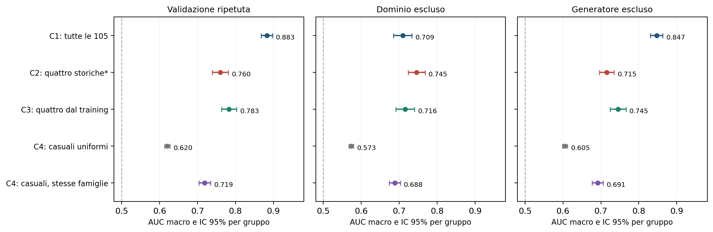
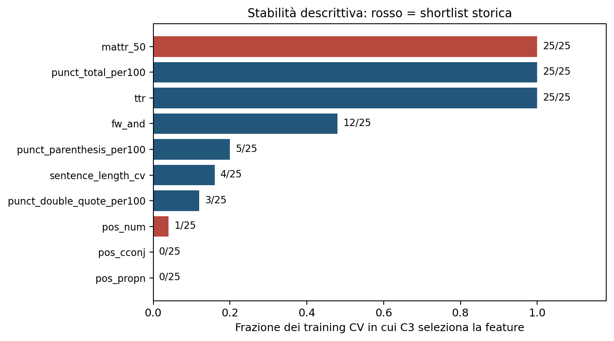

# Quattro feature stilometriche: verifica predittiva e stabilità

**Esperimento eseguito l'11 novembre 2026.** Dati storici conservati; nessun nuovo testo generato, modello linguistico o chiamata API.

## Risposta alla domanda

La shortlist storica contiene segnale: AUC CV **0,760**, contro **0,620** delle quaterne casuali uniformi e **0,719** di quelle con la stessa composizione per famiglie. Tuttavia non sostituisce il pannello completo, che raggiunge **0,883**.

Selezionando quattro feature sul solo training si ottiene AUC **0,783**. La procedura supera i due riferimenti casuali medi, ma perde **0,100 AUC** rispetto alle 105 feature. Fra le quattro caratteristiche storiche, solo **MATTR** viene selezionata in tutti i 35 training. Questo risultato non conferma indipendentemente la shortlist e non identifica un insieme unico di quattro indicatori ottimali.

## Che cosa abbiamo confrontato

Il campione contiene **1.800 testi: 900 umani e 900 macchina**, suddivisi in 300 abbinamenti per ciascuno di Essay, Reuters e WritingPrompts. Ogni abbinamento ha lo stesso numero di parole lessicali. Non significa che umano e macchina abbiano lo stesso contenuto: sono associazioni del disegno di campionamento, non coppie di parafrasi. Ogni gruppo del campione congelato contiene un umano e una macchina; i due testi rimangono sempre insieme nelle partizioni.

- **C1 Full:** tutte le 105 feature, compresi indicatori diagnostici come TTR e conteggi generali.
- **C2 Fixed:** `pos_num`, `pos_cconj`, `mattr_50`, `pos_propn`. I loro nomi erano già stati scelti sull'intero campione: tutti i risultati C2, contrassegnati con un asterisco, restano esplorativi.
- **C3 Training:** quattro feature con maggiore valore assoluto del g di Hedges sul training. Si rimuovono candidati con correlazione assoluta di Spearman almeno 0,85 con una feature già scelta. Ranking, correlazioni e gestione dei mancanti non usano il test. È una nuova regola, distinta dal precedente filtro di coerenza fra domini e generatori.
- **C4 uniforme:** 100 quaterne casuali distinte, fissate senza consultare etichette o valori.
- **C4 famiglie:** altre 100 quaterne con tre POS e una misura lessicale, come composizione della shortlist. Controlla il fatto che 59 delle 105 colonne riguardino parole funzionali.

La regressione logistica mantiene C=1, bilanciamento delle classi e regolarizzazione L2. Imputazione con mediana e standardizzazione sono apprese sul solo training; nessuna ottimizzazione di iperparametri. Anche C2 riceve coefficienti appresi sul training: l'informazione precedente riguarda la scelta delle colonne, non il fit dei coefficienti.

La validazione usa cinque fold per gruppo, ripetuti con cinque semi e cinque partizioni realmente diverse. Si aggiungono tre test lasciando fuori un dominio e sette lasciando fuori un generatore. Tutte le configurazioni condividono le partizioni. Sono completati **7.210 fit**, con **0 avvisi di convergenza**; fit finali circa 76 secondi, analisi statistica circa 5 secondi su CPU.

Nella CV principale il training comprende esempi di tutti e tre i domini; ogni test contiene gruppi esclusi da quel training. L'AUC viene poi calcolata separatamente per dominio. Nel leave-one-domain-out, invece, il dominio di test è interamente assente dal training.

La misura principale è la **media delle AUC dei tre domini**, ulteriormente mediata fra le cinque ripetizioni. Nel trasferimento fra generatori si mediano le sette AUC. Per C4 si mediano le AUC delle quaterne, non le probabilità: non è un ensemble. AUC 0,5 indica un ordinamento vicino al caso e AUC 1 una separazione completa; non è una percentuale di testi classificati correttamente.

Gli intervalli usano **2.000 ricampionamenti appaiati dei gruppi**, mantenendo insieme tutte le ripetizioni dello stesso testo. Sono condizionati alle predizioni salvate: non includono tutta l'incertezza del riaddestramento o della scelta del protocollo. Sono intervalli puntuali esplorativi, senza correzione complessiva per confronti multipli.

## Risultato principale

| Configurazione | AUC | IC 95% per gruppo |
| --- | --- | --- |
| C1: tutte le 105 | 0,883 | [0,868; 0,897] |
| C2: quattro storiche* | 0,760 | [0,739; 0,781] |
| C3: quattro dal training | 0,783 | [0,763; 0,803] |
| C4: casuali uniformi | 0,620 | [0,613; 0,627] |
| C4: casuali, stesse famiglie | 0,719 | [0,704; 0,734] |

Nota su C2: le quattro colonne sono state scelte sul campione completo prima di questa analisi; non è una conferma su dati indipendenti. Gli intervalli C4 riguardano la media delle quaterne fissate, non la dispersione fra singole quaterne.

Le AUC CV dei singoli domini, con training che comprende tutti e tre i domini, sono:

| Dominio valutato | C1 Full | C2 Fixed* | C3 Training |
| --- | --- | --- | --- |
| Essay | 0,869 | 0,771 | 0,779 |
| Reuters | 0,905 | 0,809 | 0,789 |
| WritingPrompts | 0,874 | 0,701 | 0,779 |

| Confronto appaiato CV | Differenza AUC | IC 95% |
| --- | --- | --- |
| C3: quattro dal training meno C1: tutte le 105 | -0,100 | [-0,119; -0,082] |
| C3: quattro dal training meno C2: quattro storiche* | 0,022 | [0,005; 0,040] |
| C3: quattro dal training meno C4: casuali uniformi | 0,162 | [0,145; 0,180] |
| C3: quattro dal training meno C4: casuali, stesse famiglie | 0,064 | [0,053; 0,075] |
| C2: quattro storiche* meno C1: tutte le 105 | -0,123 | [-0,143; -0,102] |
| C2: quattro storiche* meno C4: casuali, stesse famiglie | 0,041 | [0,028; 0,054] |

Le quattro feature selezionate nel training migliorano rispetto alla shortlist storica nella CV, ma il pannello completo conserva un vantaggio netto. Non è stato fissato un margine di non inferiorità: non si dichiara equivalenza fra modelli.

## Quanto conta il riferimento casuale

| Protocollo | Estrazione | Mediana AUC | Quantili 2,5–97,5% | Almeno C2* | Almeno C3 |
| --- | --- | --- | --- | --- | --- |
| Validazione ripetuta | Uniforme | 0,614 | 0,526–0,731 | 0/100 | 0/100 |
| Validazione ripetuta | Stesse famiglie | 0,736 | 0,590–0,784 | 23/100 | 4/100 |
| Dominio escluso | Uniforme | 0,576 | 0,442–0,719 | 0/100 | 3/100 |
| Dominio escluso | Stesse famiglie | 0,704 | 0,501–0,767 | 22/100 | 40/100 |
| Generatore escluso | Uniforme | 0,597 | 0,494–0,715 | 4/100 | 0/100 |
| Generatore escluso | Stesse famiglie | 0,714 | 0,544–0,759 | 48/100 | 13/100 |

I quantili nella tabella descrivono la **dispersione fra le 100 quaterne** e non sono intervalli di confidenza. Le ultime colonne contano quante quaterne eguagliano o superano le AUC di C2 e C3. Non sono p-value né misure di ottimalità.

In CV nessuna delle 100 quaterne uniformi raggiunge C2, ma **23 su 100** quaterne delle stesse famiglie la raggiungono o superano. Nel trasferimento a generatori esclusi il conteggio diventa **48 su 100**. Parte del vantaggio rispetto al caso dipende quindi anche dalle famiglie considerate; la specifica shortlist non emerge come scelta unica. C3 supera la media dei due riferimenti, senza superare ogni singola quaterna.

## Quali feature vengono scelte davvero

| Feature | CV: 25 training | Domini: 3 | Generatori: 7 |
| --- | --- | --- | --- |
| mattr_50 | 25/25 | 3/3 | 7/7 |
| pos_num | 1/25 | 0/3 | 1/7 |
| pos_cconj | 0/25 | 0/3 | 0/7 |
| pos_propn | 0/25 | 0/3 | 0/7 |
| ttr | 25/25 | 3/3 | 7/7 |
| punct_total_per100 | 25/25 | 1/3 | 7/7 |
| fw_and | 12/25 | 0/3 | 3/7 |

Le frequenze sono descrittive: i training si sovrappongono e non sono 35 prove indipendenti. **MATTR** misura la varietà lessicale su finestre di 50 parole; **TTR** misura il rapporto fra parole diverse e parole totali; `punct_total_per100` è la frequenza complessiva della punteggiatura; `fw_and` è la frequenza di “and”. TTR è ammessa perché il nuovo insieme candidato comprende tutte le 105 feature; era esclusa dal classificatore stilometrico storico principale per la sua sensibilità alla lunghezza.

Nella CV, MATTR, TTR e punteggiatura totale compaiono sempre; il quarto posto cambia. Della shortlist storica, numerali compare raramente, mentre congiunzioni coordinanti e nomi propri non vengono selezionati da C3. **Questo non dimostra che siano inutili:** possono contenere informazione già rappresentata da altre colonne e la nuova regola massimizza un effetto aggregato, mentre quella storica cercava coerenza fra domini e generatori.

## Trasferimento a domini e generatori esclusi

| Protocollo | C1 | C2* | C3 | C4 uniforme | C4 famiglie |
| --- | --- | --- | --- | --- | --- |
| Validazione ripetuta | 0,883 | 0,760 | 0,783 | 0,620 | 0,719 |
| Dominio escluso | 0,709 | 0,745 | 0,716 | 0,573 | 0,688 |
| Generatore escluso | 0,847 | 0,715 | 0,745 | 0,605 | 0,691 |

Nel trasferimento fra domini C3 e C1 sono vicini: differenza **0,006**, IC 95% **[-0,019; 0,032]**. Questo non prova equivalenza. Il valore apparentemente migliore di C2 non può essere interpretato come conferma su domini mai visti: il dominio era escluso dal fit della regressione, ma era già stato usato nella selezione storica delle quattro colonne.

| Test escluso | C1 Full | C2 Fixed* | C3 Training |
| --- | --- | --- | --- |
| Essay | 0,737 | 0,762 | 0,697 |
| Reuters | 0,785 | 0,775 | 0,750 |
| WritingPrompts | 0,605 | 0,699 | 0,700 |

La selezione C3 cambia usando esclusivamente gli altri due domini:

| Dominio escluso | Quattro scelte sul training degli altri due domini |
| --- | --- |
| Essay | `ttr`, `mattr_50`, `sentence_length_cv`, `punct_double_quote_per100` |
| Reuters | `ttr`, `punct_total_per100`, `mattr_50`, `punct_parenthesis_per100` |
| WritingPrompts | `ttr`, `mattr_50`, `fw_has`, `punct_parenthesis_per100` |

Nel trasferimento fra generatori il pannello completo conserva più segnale. La media nasconde differenze importanti:

| Test escluso | C1 Full | C2 Fixed* | C3 Training |
| --- | --- | --- | --- |
| ChatGLM | 0,955 | 0,860 | 0,929 |
| ChatGPT | 0,917 | 0,719 | 0,789 |
| ChatGPT-turbo | 0,884 | 0,549 | 0,571 |
| Claude | 0,721 | 0,527 | 0,598 |
| Dolly | 0,807 | 0,742 | 0,750 |
| GPT4All | 0,944 | 0,776 | 0,836 |
| StableLM | 0,699 | 0,832 | 0,743 |

Gli intervalli per ciascun dominio e generatore sono conservati in `metrics.csv`. I sette generatori sono quelli storici del corpus; questi risultati non riguardano automaticamente modelli contemporanei o output di humanizer. In particolare, la shortlist fissa è poco separante su Claude e ChatGPT-turbo.

## Confronto con i pannelli storici

| Pannello | CV macro | Dominio escluso | Generatore escluso |
| --- | --- | --- | --- |
| C1: tutte le 105 | 0,883 | 0,709 | 0,847 |
| Riferimento: 100 | 0,865 | 0,673 | 0,825 |
| Riferimento: 93 | 0,864 | 0,670 | 0,823 |
| Solo numero di parole | 0,500 | 0,500 | 0,500 |

Il pannello da 100 rimuove `n_words`, `n_characters`, `n_sentences`, `ttr`, `hapax_ratio`; quello da 93 rimuove anche le sette misure usate dal riferimento Wikipedia. Questi risultati sono ricalcolati sulle partizioni nuove, non copiati dalle vecchie AUC entro dominio. Il solo numero di parole rimane a **0,500 in ogni protocollo**, coerentemente con il matching esatto. Non basta però a eliminare tutti gli effetti della lunghezza o del contenuto.

## Conclusione utilizzabile nella tesi

> La rappresentazione compatta contiene informazione discriminante, ma non recupera tutta la prestazione del pannello completo. Una selezione di quattro caratteristiche limitata al training supera i riferimenti casuali medi, mentre la composizione delle famiglie influenza fortemente il confronto. MATTR è la caratteristica della shortlist storica più stabile rispetto alla nuova regola. Non è tuttavia dimostrata l'ottimalità o la validità indipendente dell'insieme fisso di quattro caratteristiche.

Le conclusioni restano sul riconoscimento umano/macchina in questo corpus. Numerali e nomi propri possono dipendere anche dall'argomento; il matching delle parole non garantisce contenuto equivalente. Una nuova conferma della shortlist richiede gruppi mai utilizzati per sceglierla. Non si sostituisce automaticamente la shortlist con le feature più frequenti dopo questa analisi e non si attribuisce alla loro AUC una misura di naturalezza o di riuscita della humanization.

## Codice, materiali e verifica

Il protocollo è in [protocol.json](protocol.json) e nella specifica `SHORTLIST_VALIDATION.md` alla radice del progetto. `scripts/run_shortlist_validation.py` esegue i modelli; `scripts/analyze_shortlist_validation.py` calcola tabelle, intervalli, grafici e questo report. I moduli sono `stylometry/shortlist_validation.py`, `stylometry/shortlist_statistics.py` e `stylometry/shortlist_report.py`.

Sono salvati: [metriche](metrics.csv), [differenze appaiate](paired_differences.csv), [frequenze di tutte le feature](selection_frequency.csv), [famiglie selezionate](selection_family_frequency.csv), [quaterne casuali](random_subsets.csv), [loro risultati](random_subset_metrics.csv), [distribuzioni casuali](random_reference_summary.csv), [selezioni per training](selections.csv), [coefficienti delle quattro feature](coefficients.csv), [audit delle partizioni](split_audit.csv) e predizioni numeriche compresse in `predictions.npz`.

Il controllo indipendente verifica 900 gruppi, cinque partizioni CV distinte, nessuna sovrapposizione training/test e nessun dominio o generatore escluso presente nel relativo training. Nove test sintetici controllano selezione, standardizzazione, ridondanza, partizioni e calcolo dell'AUC appaiata. Il CSV delle feature storico è invariato.

Nota di implementazione: il primo tentativo produceva partizioni identiche cambiando seme, perché ogni gruppo aveva la stessa composizione di classe. È escluso prima dell'analisi AUC. Si è corretta soltanto la randomizzazione dei codici dei gruppi; il protocollo v1.1 è fissato prima dei fit finali. La traccia è in [implementation_note.json](implementation_note.json). Nessuna scelta di feature, soglia o classificatore è stata cambiata sulla base delle prestazioni del primo tentativo.
