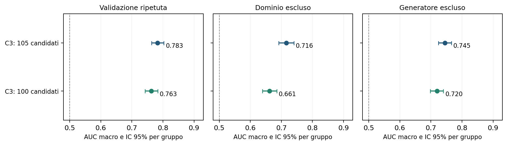
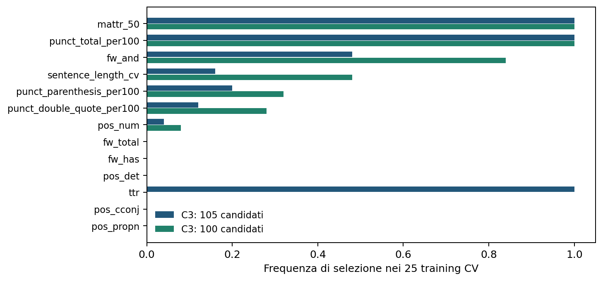

# Robustezza di C3: selezione da 100 candidati senza cinque indicatori diagnostici

**Esperimento aggiuntivo dell'11 novembre 2026.** Si confronta la procedura di selezione delle feature, non la qualità della humanization.

## Risposta alla domanda

Selezionando quattro feature dai 100 candidati si ottiene AUC CV macro **0,763**, rispetto a **0,783** con i 105 candidati. La differenza appaiata, 100 meno 105, è **-0,020**, IC 95% **[-0,032; -0,007]**. Nel confronto principale l'esclusione dei cinque indicatori riduce la separazione: l'intervallo della differenza è interamente negativo.

`mattr_50` viene selezionata **35/35** volte con il pannello ridotto. L'esclusione impedisce a TTR di occupare uno dei quattro posti e permette di osservare quali caratteristiche la sostituiscono. Le feature selezionate soltanto nel nuovo controllo sono: `pos_det`. Non si promuove automaticamente una nuova shortlist sulla base di questi esiti.

## Metodo: cambia soltanto l'insieme candidato

Si riutilizzano gli stessi **1.800 testi, 900 gruppi**, con numero di parole lessicali abbinato fra umano e macchina. Gli abbinamenti non sono necessariamente parafrasi dello stesso contenuto. Le partizioni sono caricate dal file già salvato nell'esperimento precedente, senza rigenerarle: 25 training della CV ripetuta, tre con un dominio escluso e sette con un generatore escluso.

Il pannello ridotto esclude esattamente `n_words`, `n_characters`, `n_sentences`, `ttr` e `hapax_ratio`. Le altre 100 colonne rimangono candidate. In ogni training si ordinano le feature per valore assoluto del g di Hedges e si selezionano progressivamente quattro colonne, scartando correlazioni assolute di Spearman almeno 0,85 con quelle già scelte. Calcolo degli effetti, correlazioni, imputazione con mediana e standardizzazione usano soltanto il training.

**Entrambi i classificatori usano soltanto quattro feature:** 105 e 100 indicano quante colonne sono disponibili per sceglierle, non quante entrano nel modello finale. Il riferimento è quindi C3 con 105 candidati, non C1 che utilizza direttamente tutte le 105 feature.

La regressione logistica resta quella precedente: C=1, regolarizzazione L2, classi bilanciate, solver lbfgs, nessuna ottimizzazione degli iperparametri. Sono eseguiti soltanto **35 nuovi fit** per C3 con 100 candidati. Le predizioni del riferimento da 105 sono riprese esattamente dal run precedente; AUC e intervalli del riferimento sono riprodotti entro la tolleranza numerica di 10^-12. Nessuna generazione di testi o chiamata API.

La misura principale è la media delle AUC dei tre domini, ulteriormente mediata fra le cinque ripetizioni. Nel leave-one-generator-out si mediano le sette AUC. Gli intervalli usano gli stessi 2.000 bootstrap appaiati per gruppo, mantenendo insieme tutte le ripetizioni e usando le stesse estrazioni nei due modelli. Sono intervalli puntuali ed esplorativi, condizionati alle predizioni salvate: non comprendono tutta l'incertezza del riaddestramento. I 35 training si sovrappongono e non sono prove indipendenti.

## Prestazione e differenze appaiate

| Selezione di quattro feature | AUC CV macro | IC 95% per gruppo |
| --- | --- | --- |
| C3_105 | 0,783 | [0,763; 0,803] |
| C3_100 | 0,763 | [0,743; 0,783] |

| Protocollo | C3: 105 candidati | C3: 100 candidati | 100 meno 105 | IC 95% differenza |
| --- | --- | --- | --- | --- |
| Validazione ripetuta | 0,783 | 0,763 | -0,020 | [-0,032; -0,007] |
| Dominio escluso | 0,716 | 0,661 | -0,054 | [-0,072; -0,038] |
| Generatore escluso | 0,745 | 0,720 | -0,026 | [-0,040; -0,012] |

Le differenze sono espresse in unità di AUC, non in percentuali di accuratezza. Non è stato fissato un margine di non inferiorità: un intervallo che comprende zero non dimostra equivalenza.

Il confronto appaiato considera gli stessi testi e gli stessi training: l'intervallo della differenza non si deduce dal semplice sovrapporsi degli intervalli delle due AUC. In questo campione le tre differenze macro sono negative. Il segnale rimane sopra il caso, ma non si conserva interamente la prestazione precedente.

## Stabilità della selezione

Nelle celle della tabella si confrontano **conteggio/numero di training con 105 candidati**, poi, dopo il punto e virgola, **conteggio/numero di training con 100 candidati**. La dicitura “esclusa” indica non ammissibilità, non assenza di informazione.

| Feature | CV: 105; 100 | Domini: 105; 100 | Generatori: 105; 100 |
| --- | --- | --- | --- |
| mattr_50 | 25/25; 25/25 | 3/3; 3/3 | 7/7; 7/7 |
| punct_total_per100 | 25/25; 25/25 | 1/3; 1/3 | 7/7; 7/7 |
| fw_and | 12/25; 21/25 | 0/3; 0/3 | 3/7; 5/7 |
| sentence_length_cv | 4/25; 12/25 | 1/3; 1/3 | 2/7; 2/7 |
| punct_parenthesis_per100 | 5/25; 8/25 | 2/3; 2/3 | 0/7; 2/7 |
| punct_double_quote_per100 | 3/25; 7/25 | 1/3; 1/3 | 0/7; 2/7 |
| pos_num | 1/25; 2/25 | 0/3; 2/3 | 1/7; 1/7 |
| fw_total | 0/25; 0/25 | 0/3; 0/3 | 1/7; 2/7 |
| fw_has | 0/25; 0/25 | 1/3; 1/3 | 0/7; 0/7 |
| pos_det | 0/25; 0/25 | 0/3; 1/3 | 0/7; 0/7 |
| ttr | 25/25; esclusa | 3/3; esclusa | 7/7; esclusa |
| pos_cconj | 0/25; 0/25 | 0/3; 0/3 | 0/7; 0/7 |
| pos_propn | 0/25; 0/25 | 0/3; 0/3 | 0/7; 0/7 |

Le frequenze descrivono la regola di selezione, non l'importanza causale o l'utilità individuale di una feature. Caratteristiche correlate possono sostituirsi. MATTR misura la varietà lessicale su finestre di 50 parole; la punteggiatura totale riassume i segni per 100 parole; `fw_and` misura la frequenza di “and”. La shortlist storica di quattro nomi rimane distinta dalle quaterne selezionate nel training.

## Trasferimento a domini e generatori esclusi

Il dominio o generatore indicato nella tabella è assente dal training. Le AUC dei due modelli e la differenza sono calcolate sugli stessi testi.

| Test | 105 candidati | 100 candidati | Differenza | IC 95% differenza |
| --- | --- | --- | --- | --- |
| Essay | 0,697 | 0,565 | -0,132 | [-0,163; -0,105] |
| Reuters | 0,750 | 0,745 | -0,005 | [-0,040; 0,028] |
| WritingPrompts | 0,700 | 0,675 | -0,025 | [-0,050; -0,002] |

Il calo fra domini è concentrato soprattutto su **Essay: AUC da 0,697 a 0,565**. Reuters cambia poco, mentre WritingPrompts cala meno di Essay. La stabilità di selezione di MATTR non garantisce quindi, da sola, una buona generalizzazione del classificatore a ogni dominio.

Le quaterne selezionate dai 100 candidati sui soli due domini di training sono:

| Dominio escluso | Quattro scelte dai 100 candidati nel training |
| --- | --- |
| Essay | `mattr_50`, `sentence_length_cv`, `punct_double_quote_per100`, `pos_det` |
| Reuters | `punct_total_per100`, `mattr_50`, `punct_parenthesis_per100`, `pos_num` |
| WritingPrompts | `mattr_50`, `fw_has`, `punct_parenthesis_per100`, `pos_num` |

| Test | 105 candidati | 100 candidati | Differenza | IC 95% differenza |
| --- | --- | --- | --- | --- |
| ChatGLM | 0,929 | 0,885 | -0,045 | [-0,072; -0,021] |
| ChatGPT | 0,789 | 0,768 | -0,021 | [-0,058; 0,014] |
| ChatGPT-turbo | 0,571 | 0,569 | -0,002 | [-0,040; 0,038] |
| Claude | 0,598 | 0,559 | -0,039 | [-0,078; 0,002] |
| Dolly | 0,750 | 0,765 | 0,015 | [-0,025; 0,055] |
| GPT4All | 0,836 | 0,789 | -0,046 | [-0,083; -0,012] |
| StableLM | 0,743 | 0,702 | -0,041 | [-0,083; 0,001] |

Le AUC CV dei singoli domini, con training che contiene tutti e tre i domini e gruppi di test separati, sono:

| Test | 105 candidati | 100 candidati | Differenza | IC 95% differenza |
| --- | --- | --- | --- | --- |
| Essay | 0,779 | 0,748 | -0,032 | [-0,055; -0,009] |
| Reuters | 0,789 | 0,771 | -0,018 | [-0,042; 0,006] |
| WritingPrompts | 0,779 | 0,770 | -0,010 | [-0,027; 0,008] |

## Interpretazione e limiti

Il confronto quantifica la dipendenza della selezione dall'ammissione dei cinque indicatori diagnostici. Nel confronto principale l'esclusione dei cinque indicatori riduce la separazione: l'intervallo della differenza è interamente negativo. Il comportamento sui domini e sui generatori va letto separatamente dalla media: non si presume un vantaggio uniforme in tutti i casi.

**Rimuovere queste cinque colonne non rende le altre automaticamente indipendenti dalla lunghezza.** MATTR riduce la dipendenza del semplice rapporto tipi/token, ma anche misure normalizzate o basate su finestre possono cambiare con la quantità di testo e con la sua composizione. Inoltre, eliminare cinque colonne insieme non identifica un effetto causale separato di ciascuna; per la regola usata, le selezioni precedenti mostrano quale di esse occupasse posti nella quaterna.

Rimangono anche caratteristiche della struttura frasale, come `sentence_length_cv`, che passa da 4/25 a 12/25 selezioni nella CV. Questo controllo esclude i cinque indicatori dichiarati, non tutte le misure relative alla lunghezza delle frasi. Fra le cinque colonne rimosse, soltanto TTR era stata selezionata nel confronto precedente, in tutti i 35 training.

Un eventuale calo dopo l'esclusione di TTR non dimostra che il segnale precedente fosse un effetto spurio della lunghezza: il numero di parole era già abbinato, e TTR può riflettere anche differenze reali nella ripetizione e varietà del lessico.

Il matching delle parole e la selezione sul solo training non eliminano differenze di argomento o artefatti del corpus. La verifica rimane successiva all'esplorazione dei dati e non costituisce una conferma indipendente di una lista fissa. Non misura naturalezza, fedeltà semantica o riuscita di uno humanizer. Il suo risultato riguarda la robustezza di una procedura predittiva su questo campione.

## Materiali e riproduzione

Il [protocollo](protocol.json) identifica dati, partizioni e riferimento precedente. Sono disponibili [AUC e intervalli](metrics.csv), [differenze appaiate](paired_differences.csv), [frequenze complete](selection_frequency.csv), [confronto fra selezioni](selection_comparison.csv), [selezioni per training](selections.csv), [audit delle partizioni](split_audit.csv), [manifest dei fit](manifest.json) e [manifest statistico](statistics_manifest.json). Le predizioni complete e le AUC bootstrap sono salvate nei due file NPZ.

`scripts/run_shortlist_length_robustness.py` esegue i soli nuovi modelli; `scripts/analyze_shortlist_length_robustness.py` ricalcola tabelle, intervalli, figure e questo report senza ripetere i fit. Gli output storici restano invariati.
