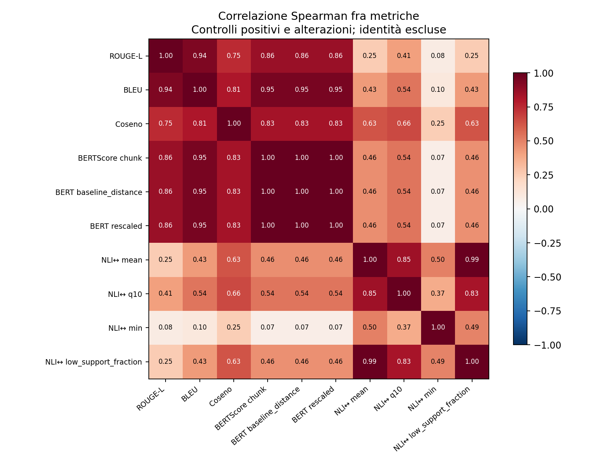

# Controlli positivi e scelta dell’aggregatore semantico

Il confronto valuta la separazione fra modifiche presumibilmente conservative (Polish, Paraphrase, Style Rewrite OpAI) e alterazioni intenzionali. Le etichette operative e le regole **non sono gold label umane**. Identità, fixture e shuffle sono esclusi dall’AUC principale; lo shuffle può cambiare coerenza senza cambiare le proposizioni.

## Disegno e campione

| dataset | perturbation | evaluation_split | n_pairs | n_sources |
| --- | --- | --- | --- | --- |
| controlled | entity_substitution | calibration | 96 | 96 |
| controlled | entity_substitution | test | 104 | 104 |
| controlled | negation | calibration | 96 | 96 |
| controlled | negation | test | 104 | 104 |
| controlled | random_deletion | calibration | 96 | 96 |
| controlled | random_deletion | test | 104 | 104 |
| controlled | truncate | calibration | 96 | 96 |
| controlled | truncate | test | 104 | 104 |
| controlled_subtle | hedge_removal | calibration | 18 | 18 |
| controlled_subtle | hedge_removal | test | 21 | 21 |
| controlled_subtle | number_change | calibration | 20 | 20 |
| controlled_subtle | number_change | test | 30 | 30 |
| controlled_subtle | quantifier_strengthening | calibration | 24 | 24 |
| controlled_subtle | quantifier_strengthening | test | 26 | 26 |
| controlled_subtle | unsupported_detail | calibration | 6 | 6 |
| controlled_subtle | unsupported_detail | test | 7 | 7 |
| opai_matched_negative | matched_entity_substitution | calibration | 129 | 42 |
| opai_matched_negative | matched_entity_substitution | test | 122 | 41 |
| opai_matched_negative | matched_hedge_removal | calibration | 15 | 7 |
| opai_matched_negative | matched_hedge_removal | test | 9 | 5 |
| opai_matched_negative | matched_negation | calibration | 95 | 35 |
| opai_matched_negative | matched_negation | test | 94 | 38 |
| opai_matched_negative | matched_number_change | calibration | 26 | 18 |
| opai_matched_negative | matched_number_change | test | 24 | 18 |
| opai_matched_negative | matched_quantifier_strengthening | calibration | 28 | 11 |
| opai_matched_negative | matched_quantifier_strengthening | test | 15 | 6 |
| opai_matched_negative | matched_unsupported_detail | calibration | 4 | 2 |
| opai_matched_negative | matched_unsupported_detail | test | 1 | 1 |
| opai_positive | opai_paraphrase | calibration | 49 | 48 |
| opai_positive | opai_paraphrase | test | 51 | 51 |
| opai_positive | opai_polish | calibration | 49 | 48 |
| opai_positive | opai_polish | test | 51 | 51 |
| opai_positive | opai_style | calibration | 49 | 48 |
| opai_positive | opai_style | test | 51 | 51 |

L’unità di split e bootstrap è il documento sorgente: editor, operazioni e versioni della stessa fonte viaggiano insieme. Ogni fonte riceve uguale peso entro ciascuna classe. Il test è separato dalla calibrazione; nessuna inversione del segno viene fatta dopo aver osservato l’AUC.

Il confronto principale **opai_matched_primary** usa gli stessi originali e le stesse trasformazioni OpAI: un negativo è la versione positiva ulteriormente corrotta, e conserva lo stesso originale del positivo. Si includono soltanto positivi collegati ad almeno un negativo applicabile. Questo riduce il confondente del corpus, ma la separazione può ancora dipendere dalle perturbazioni artificiali.

Le analisi mixed_corpus_secondary e subtle_cross_corpus_secondary conservano il confondente OpAI/MGTBench e sono diagnostiche. I domini senza entrambe le classi non producono un’AUC di dominio. L’AUC aggregata dipende dalla composizione osservata dei tipi di alterazione; non stima una prevalenza reale degli errori degli humanizer. Le AUC stratificate evitano che un buon risultato sulle negazioni nasconda errori su numeri, quantificatori o cautele.

Nel campione OpAI appaiato, **440/562 negativi** sono negazioni o sostituzioni di entità. La metrica principale assegna uguale peso alle fonti entro ciascuna classe, ma rimane dipendente dalla composizione degli errori. Il confronto separato dei soli sottili sotto riduce questa dominanza.

## AUC sul test separato

Classe 1 = alterazione intenzionale; un valore più alto dello score di rischio significa maggiore alterazione. AUC 0,5 indica ranking casuale; valori inferiori non sono ribaltati. IC 95% bootstrap percentile per fonte. Nei campioni appaiati finiti il ricampionamento può spostare gli IC, soprattutto per AUC deboli vicino a 0,5, e un IC percentile può non contenere la stima puntuale. Non usare questi intervalli per dichiarare ROUGE/BERTScore superiori al caso o piccole differenze fra aggregatori come dimostrate.

| metric | n_pairs | n_sources | auc | ci_low | ci_high |
| --- | --- | --- | --- | --- | --- |
| lexical_rouge_l_f1 | 406 | 48 | 0.537 | 0.529 | 0.551 |
| lexical_bleu | 406 | 48 | 0.536 | 0.526 | 0.550 |
| embedding_cosine | 406 | 48 | 0.599 | 0.581 | 0.622 |
| bert_chunk_f1 | 406 | 48 | 0.544 | 0.532 | 0.560 |
| bert_chunk_f1_baseline_distance | 406 | 48 | 0.544 | 0.533 | 0.560 |
| bert_chunk_f1_rescaled | 406 | 48 | 0.544 | 0.533 | 0.560 |
| nli_forward_mean | 406 | 48 | 0.951 | 0.921 | 0.976 |
| nli_reverse_mean | 406 | 48 | 0.908 | 0.868 | 0.944 |
| nli_bidirectional_mean | 406 | 48 | 0.929 | 0.891 | 0.962 |
| nli_forward_q10 | 406 | 48 | 0.741 | 0.691 | 0.794 |
| nli_reverse_q10 | 406 | 48 | 0.713 | 0.671 | 0.766 |
| nli_bidirectional_q10 | 406 | 48 | 0.728 | 0.686 | 0.779 |
| nli_forward_min | 406 | 48 | 0.966 | 0.946 | 0.985 |
| nli_reverse_min | 406 | 48 | 0.931 | 0.896 | 0.960 |
| nli_bidirectional_min | 406 | 48 | 0.958 | 0.931 | 0.979 |
| nli_forward_low_support_fraction | 406 | 48 | 0.929 | 0.896 | 0.959 |
| nli_reverse_low_support_fraction | 406 | 48 | 0.890 | 0.853 | 0.927 |
| nli_bidirectional_low_support_fraction | 406 | 48 | 0.908 | 0.872 | 0.942 |

Aggregatore scelto usando soltanto calibration: **nli_bidirectional_min**. Le prestazioni test riportate sotto non partecipano alla scelta. La scelta resta esplorativa perché le etichette sono proxy.

Il confronto di tutti gli aggregatori sul test è descrittivo; il valore del solo aggregatore scelto in calibration è la valutazione successiva alla scelta. La conservazione richiede entrambe le direzioni: per mean/q10/min si prende il supporto minore tra forward e reverse; per la quota non supportata si prende la maggiore.

## Controllo difficile entro fonte: sole alterazioni sottili OpAI

Il cohort opai_matched_subtle_secondary contiene cambi numerici, rafforzamenti di quantificatori, rimozioni di cautele e aggiunte di dettagli non supportati, insieme agli **esatti positivi collegati**. Usa gli split per fonte già fissati e non introduce confronti OpAI/MGTBench. La sua selezione in calibration è esplorativa, non una ricerca di un aggregatore universale.

| metric | n_pairs | n_sources | auc | ci_low | ci_high |
| --- | --- | --- | --- | --- | --- |
| lexical_rouge_l_f1 | 91 | 25 | 0.522 | 0.522 | 0.551 |
| lexical_bleu | 91 | 25 | 0.524 | 0.524 | 0.551 |
| embedding_cosine | 91 | 25 | 0.531 | 0.522 | 0.566 |
| bert_chunk_f1 | 91 | 25 | 0.525 | 0.527 | 0.558 |
| nli_bidirectional_mean | 91 | 25 | 0.885 | 0.819 | 0.946 |
| nli_bidirectional_q10 | 91 | 25 | 0.657 | 0.609 | 0.728 |
| nli_bidirectional_min | 91 | 25 | 0.900 | 0.820 | 0.964 |
| nli_bidirectional_low_support_fraction | 91 | 25 | 0.833 | 0.750 | 0.910 |

Aggregatore scelto soltanto sulla calibrazione dei sottili: **nli_bidirectional_min**. La scelta e la soglia principali vengono inoltre trasferite a questo test senza riottimizzazione nella sezione successiva.

Nel test ci sono soltanto **1 aggiunte di dettaglio** e **9 rimozioni di cautela**. Un’AUC su un solo caso non è conclusiva; gli IC bootstrap sono omessi quando una classe ha meno di cinque fonti. Fra cinque e nove fonti i risultati sono esplicitamente piccoli campioni esplorativi. `auc_by_stratum.csv` conserva i conteggi di coppie e fonti per ciascuna classe e la nota di incertezza.

## Falsi allarmi sulle buone riscritture

Per ciascuna metrica la soglia è fissata sui soli positivi di calibration, mirando a FPR ≤ 10%. Si segnala alterazione solo quando il rischio supera strettamente la soglia; i pareggi sono conservativi. Sul test si misurano FPR (riscritture presunte buone segnalate) e sensibilità alle alterazioni. Non sono tassi su parafrasi certificate da annotatori.

| metric | threshold | false_positive_rate | sensitivity | balanced_accuracy |
| --- | --- | --- | --- | --- |
| lexical_rouge_l_f1 | -0.840 | 0.118 | 0.140 | 0.511 |
| lexical_bleu | -0.736 | 0.090 | 0.109 | 0.509 |
| embedding_cosine | -0.988 | 0.069 | 0.122 | 0.527 |
| bert_chunk_f1 | -0.982 | 0.115 | 0.137 | 0.511 |
| bert_chunk_f1_baseline_distance | -0.168 | 0.115 | 0.137 | 0.511 |
| bert_chunk_f1_rescaled | -0.905 | 0.115 | 0.137 | 0.511 |
| nli_forward_mean | -0.956 | 0.049 | 0.791 | 0.871 |
| nli_reverse_mean | -0.949 | 0.069 | 0.631 | 0.781 |
| nli_bidirectional_mean | -0.941 | 0.069 | 0.638 | 0.784 |
| nli_forward_q10 | -0.976 | 0.177 | 0.523 | 0.673 |
| nli_reverse_q10 | -0.975 | 0.163 | 0.481 | 0.659 |
| nli_bidirectional_q10 | -0.964 | 0.076 | 0.394 | 0.659 |
| nli_forward_min | -0.496 | 0.076 | 0.918 | 0.921 |
| nli_reverse_min | -0.075 | 0.056 | 0.743 | 0.844 |
| nli_bidirectional_min | -0.041 | 0.076 | 0.831 | 0.877 |
| nli_forward_low_support_fraction | 0.028 | 0.076 | 0.880 | 0.902 |
| nli_reverse_low_support_fraction | 0.042 | 0.063 | 0.643 | 0.790 |
| nli_bidirectional_low_support_fraction | 0.056 | 0.069 | 0.515 | 0.723 |

I falsi allarmi per Polish, Paraphrase e Style separatamente e la sensibilità per tipo di alterazione sono in `operating_points_by_operation.csv`, sempre con soglia fissata dalla calibrazione globale.

### Allarmi su tutti i controlli positivi OpAI

Il confronto AUC principale usa 280 positivi collegati a una corruzione applicabile. Per misurare gli allarmi sull’intera popolazione positiva, `positive_controls_all_fpr.csv` include tutti i 300 positivi OpAI, anche quelli senza negativo appaiato: calibration e test, nel complesso e separatamente per Polish, Paraphrase e Style. La soglia è **quella già fissata sulla calibrazione principale** e non viene ricalibrata su questa popolazione più ampia. La FPR di calibrazione sull’intera popolazione non è quindi forzata al 10%; il test resta separato. Sono allarmi su riscritture presumibilmente conservative, non falsi allarmi certificati da annotazione umana.

| metric | n_presumed_preserved | n_sources | false_positive_rate | n_alerts |
| --- | --- | --- | --- | --- |
| lexical_rouge_l_f1 | 153 | 51 | 0.105 | 16 |
| lexical_bleu | 153 | 51 | 0.085 | 13 |
| embedding_cosine | 153 | 51 | 0.065 | 10 |
| bert_chunk_f1 | 153 | 51 | 0.105 | 16 |
| bert_chunk_f1_baseline_distance | 153 | 51 | 0.105 | 16 |
| bert_chunk_f1_rescaled | 153 | 51 | 0.105 | 16 |
| nli_forward_mean | 153 | 51 | 0.046 | 7 |
| nli_reverse_mean | 153 | 51 | 0.072 | 11 |
| nli_bidirectional_mean | 153 | 51 | 0.072 | 11 |
| nli_forward_q10 | 153 | 51 | 0.163 | 25 |
| nli_reverse_q10 | 153 | 51 | 0.157 | 24 |
| nli_bidirectional_q10 | 153 | 51 | 0.072 | 11 |
| nli_forward_min | 153 | 51 | 0.072 | 11 |
| nli_reverse_min | 153 | 51 | 0.052 | 8 |
| nli_bidirectional_min | 153 | 51 | 0.072 | 11 |
| nli_forward_low_support_fraction | 153 | 51 | 0.072 | 11 |
| nli_reverse_low_support_fraction | 153 | 51 | 0.065 | 10 |
| nli_bidirectional_low_support_fraction | 153 | 51 | 0.072 | 11 |

## Trasferimento della scelta primaria

La stessa metrica e la stessa soglia scelte in calibration sul confronto principale vengono applicate anche ai test secondari, senza riottimizzazione. I confronti MGTBench/OpAI restano confusi dal corpus e servono come diagnostica.

| test_cohort | selected_metric | auc | ci_low | ci_high | false_positive_rate | sensitivity |
| --- | --- | --- | --- | --- | --- | --- |
| opai_matched_primary | nli_bidirectional_min | 0.958 | 0.931 | 0.979 | 0.076 | 0.831 |
| opai_matched_subtle_secondary | nli_bidirectional_min | 0.900 | 0.820 | 0.964 | 0.080 | 0.707 |
| mixed_corpus_secondary | nli_bidirectional_min | 0.960 | 0.937 | 0.979 | 0.072 | 0.828 |
| subtle_cross_corpus_secondary | nli_bidirectional_min | 0.945 | 0.915 | 0.970 | 0.072 | 0.716 |
| reviewed_valid_secondary | nli_bidirectional_min | 0.968 | 0.932 | 0.994 | 0.072 | 0.833 |
| reviewed_valid_qualified_secondary | nli_bidirectional_min | 0.971 | 0.939 | 0.991 | 0.072 | 0.875 |

## Sensibilità alla revisione diretta delle perturbazioni

Sono disponibili 40 coppie lette direttamente dall’assistente senza usare i punteggi individuali, **non un’annotazione umana né un gold indipendente**. L’analisi principale conserva tutti i casi intenzionalmente alterati. Le tabelle secondarie sotto limitano soltanto i negativi al sottocampione revisionato: prima valid, poi valid+qualified. I positivi restano i controlli OpAI, quindi permane il confondente fra corpora; il piccolo campione non consente di correggere o certificare le altre perturbazioni. Non viene scelto un nuovo aggregatore su questi sottocampioni.

| cohort | metric | n_altered | n_preserved | auc | ci_low | ci_high |
| --- | --- | --- | --- | --- | --- | --- |
| reviewed_valid_secondary | lexical_rouge_l_f1 | 22 | 300 | 0.095 | 0.057 | 0.139 |
| reviewed_valid_secondary | lexical_bleu | 22 | 300 | 0.083 | 0.047 | 0.122 |
| reviewed_valid_secondary | embedding_cosine | 22 | 300 | 0.351 | 0.245 | 0.473 |
| reviewed_valid_secondary | bert_chunk_f1 | 22 | 300 | 0.118 | 0.073 | 0.167 |
| reviewed_valid_secondary | nli_bidirectional_mean | 22 | 300 | 0.932 | 0.889 | 0.966 |
| reviewed_valid_secondary | nli_bidirectional_q10 | 22 | 300 | 0.437 | 0.229 | 0.658 |
| reviewed_valid_secondary | nli_bidirectional_min | 22 | 300 | 0.973 | 0.952 | 0.989 |
| reviewed_valid_secondary | nli_bidirectional_low_support_fraction | 22 | 300 | 0.937 | 0.903 | 0.966 |
| reviewed_valid_qualified_secondary | lexical_rouge_l_f1 | 34 | 300 | 0.126 | 0.081 | 0.181 |
| reviewed_valid_qualified_secondary | lexical_bleu | 34 | 300 | 0.120 | 0.066 | 0.188 |
| reviewed_valid_qualified_secondary | embedding_cosine | 34 | 300 | 0.441 | 0.320 | 0.553 |
| reviewed_valid_qualified_secondary | bert_chunk_f1 | 34 | 300 | 0.156 | 0.099 | 0.220 |
| reviewed_valid_qualified_secondary | nli_bidirectional_mean | 34 | 300 | 0.941 | 0.905 | 0.971 |
| reviewed_valid_qualified_secondary | nli_bidirectional_q10 | 34 | 300 | 0.500 | 0.320 | 0.693 |
| reviewed_valid_qualified_secondary | nli_bidirectional_min | 34 | 300 | 0.974 | 0.956 | 0.989 |
| reviewed_valid_qualified_secondary | nli_bidirectional_low_support_fraction | 34 | 300 | 0.946 | 0.915 | 0.972 |

Un piccolo audit testuale dei positivi è documentato separatamente in [positive_review9.md](positive_review9.md). Anche questo è un giudizio dell’assistente, non annotazione umana. Alcune riscritture possono modificare specificità o agency: la FPR resta quindi un tasso di allarmi sui positivi presunti, non un tasso su parafrasi certificate.

## Correlazioni e lettura delle metriche

La correlazione è descrittiva, non source-weighted, ed è calcolata sulle coppie valutate senza identità ripetute; può essere guidata dalle differenze fra condizioni. La matrice del solo confronto OpAI appaiato è disponibile separatamente. BLEU resta nel report per confrontabilità; se ridondante con ROUGE-L e poco discriminante, può diventare una misura secondaria.

Il rescaling BERTScore è una trasformazione affine crescente per ciascuno score con baseline fissa: ne cambia la scala e la distanza dalla baseline, **non il ranking e quindi non l’AUC**. Per l’approssimazione documentale a chunk la lettura resta distinta dal BERTScore standard su una frase.

L’NLI è supporto aggregato, non una prova logica. Forward basso è compatibile con aggiunte non supportate o modifiche; reverse basso è compatibile con omissioni o modifiche: nessuna delle due direzioni identifica da sola la causa. Il minimo può essere sensibile a una sola frase difficile; q10 e media possono diluire errori isolati.

File: `metric_auc.csv`, `auc_by_stratum.csv`, `false_positive_rates.csv`, `aggregator_selection.json`, `evaluation_pairs.csv`, `metric_definitions.csv`, `metric_spearman.csv`, `operating_points_by_operation.csv`, `selected_aggregator_transfer.csv`, `positive_controls_all_fpr.csv`. I testi restano nella directory dati ignorata.
