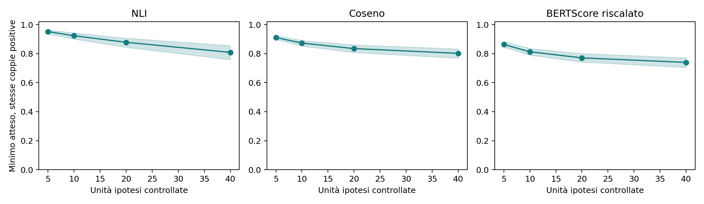

# Numero di opportunità: controllo entro la stessa coppia

Si usano soltanto coppie OpAI presunte conservative con almeno 40 unità ipotesi complessive nelle due direzioni. La coorte è identica per tutti i modelli e tutti i valori di m. Le evidenze e i punteggi delle unità rimangono fissi: si calcola esattamente il minimo atteso su un sottoinsieme uniforme di m unità, senza sostituirle e senza nuove inferenze. Le direzioni sono riunite: m conta ipotesi verificate, non frasi uniche del documento.

| metric | sampled_hypothesis_units | n_pairs | n_sources | mean | ci_low | ci_high |
| --- | --- | --- | --- | --- | --- | --- |
| BERTScore riscalato | 5 | 137 | 45 | 0.863 | 0.845 | 0.883 |
| BERTScore riscalato | 10 | 137 | 45 | 0.813 | 0.790 | 0.837 |
| BERTScore riscalato | 20 | 137 | 45 | 0.771 | 0.743 | 0.801 |
| BERTScore riscalato | 40 | 137 | 45 | 0.740 | 0.706 | 0.772 |
| Coseno | 5 | 137 | 45 | 0.911 | 0.898 | 0.925 |
| Coseno | 10 | 137 | 45 | 0.873 | 0.853 | 0.891 |
| Coseno | 20 | 137 | 45 | 0.835 | 0.809 | 0.861 |
| Coseno | 40 | 137 | 45 | 0.802 | 0.769 | 0.833 |
| NLI | 5 | 137 | 45 | 0.952 | 0.935 | 0.964 |
| NLI | 10 | 137 | 45 | 0.924 | 0.901 | 0.943 |
| NLI | 20 | 137 | 45 | 0.879 | 0.844 | 0.907 |
| NLI | 40 | 137 | 45 | 0.809 | 0.759 | 0.856 |

| metric | n_sources | mean_40_minus_5 | ci_low | ci_high |
| --- | --- | --- | --- | --- |
| BERTScore riscalato | 45 | -0.123 | -0.139 | -0.107 |
| Coseno | 45 | -0.109 | -0.129 | -0.089 |
| NLI | 45 | -0.143 | -0.182 | -0.105 |

La monotonia del minimo è una proprietà matematica; qui si quantifica la sua entità sui punteggi osservati, a contenuto e qualità della coppia fissi. La media delle unità ha invece aspettativa costante per costruzione. Questo non è un esperimento su documenti troncati né dimostra accuratezza semantica. Gli IC ricampionano le sorgenti, mantenendo insieme editor e operazioni.
