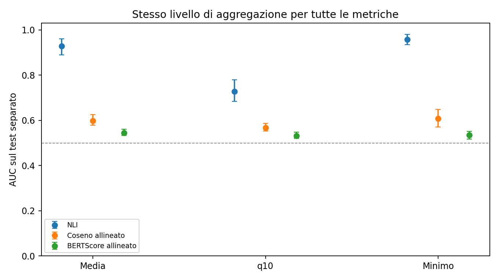
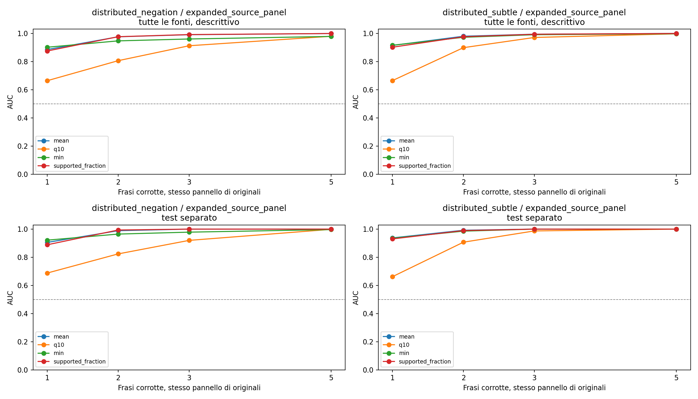
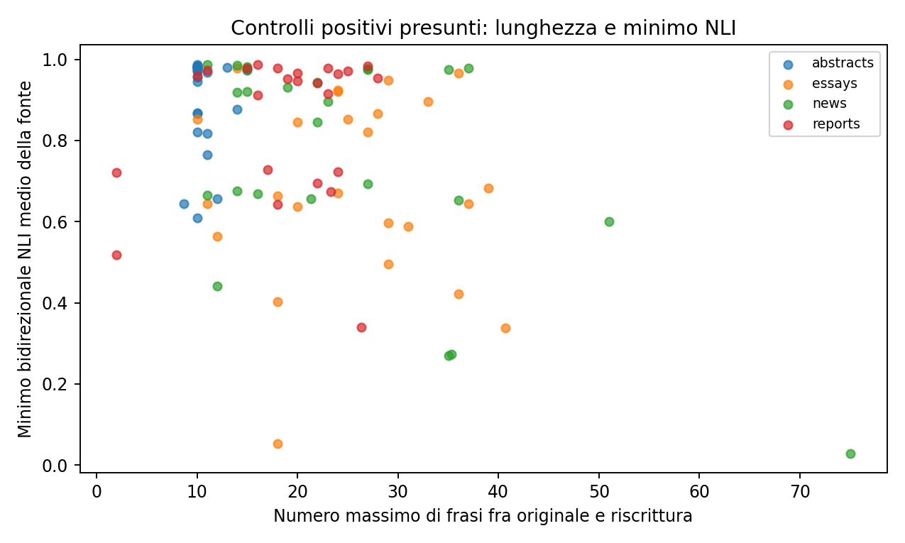

# Confronto equo delle metriche e dipendenza dalla lunghezza

Le metriche allineate lavorano sulle stesse frasi/chunk, con massimo supporto/similarità per unità ipotesi e media, q10 o minimo. Il confronto principale usa originali e riscritture OpAI appaiati, con sorgenti separate fra calibrazione e test. Le etichette rimangono proxy operative, non gold umane.

## Campione

| dataset | evaluation_split | n_pairs | n_sources |
| --- | --- | --- | --- |
| controlled | calibration | 384 | 96 |
| controlled | test | 416 | 104 |
| controlled_subtle | calibration | 68 | 66 |
| controlled_subtle | test | 84 | 74 |
| opai_distributed_negative | calibration | 451 | 71 |
| opai_distributed_negative | test | 341 | 68 |
| opai_distributed_positive | calibration | 40 | 40 |
| opai_distributed_positive | test | 47 | 47 |
| opai_matched_negative | calibration | 297 | 46 |
| opai_matched_negative | test | 265 | 48 |
| opai_positive | calibration | 147 | 48 |
| opai_positive | test | 153 | 51 |

## Stesso aggregatore per similarità e NLI

| famiglia | aggregatore | AUC | IC_basso | IC_alto | positivi | alterati |
| --- | --- | --- | --- | --- | --- | --- |
| NLI | mean | 0.929 | 0.890 | 0.962 | 141 | 265 |
| NLI | q10 | 0.728 | 0.683 | 0.780 | 141 | 265 |
| NLI | min | 0.958 | 0.935 | 0.980 | 141 | 265 |
| Coseno allineato | mean | 0.598 | 0.579 | 0.626 | 141 | 265 |
| Coseno allineato | q10 | 0.568 | 0.553 | 0.587 | 141 | 265 |
| Coseno allineato | min | 0.607 | 0.570 | 0.649 | 141 | 265 |
| BERTScore allineato | mean | 0.544 | 0.533 | 0.561 | 141 | 265 |
| BERTScore allineato | q10 | 0.532 | 0.520 | 0.547 | 141 | 265 |
| BERTScore allineato | min | 0.534 | 0.518 | 0.552 | 141 | 265 |

Coseno e BERTScore allineati prendono il massimo su tutte le unità del documento opposto. NLI conserva il protocollo precedente: massimo fra fino a tre evidenze recuperate con MiniLM. La tabella di sensibilità sotto limita anche BERTScore agli stessi tre candidati NLI. I documenti lunghi sono rappresentati da frasi/chunk senza troncamento silenzioso. L’aggregazione bidirezionale prende il supporto minore delle due direzioni; tutte le AUC hanno orientamento prefissato.

| metric | auc | ci_low | ci_high |
| --- | --- | --- | --- |
| aligned_bert_top3_f1_rescaled_bidirectional_mean | 0.544 | 0.532 | 0.560 |
| aligned_bert_top3_f1_rescaled_bidirectional_q10 | 0.532 | 0.520 | 0.548 |
| aligned_bert_top3_f1_rescaled_bidirectional_min | 0.534 | 0.519 | 0.552 |

Gli IC sono bootstrap percentile per sorgente. Nei confronti appaiati finiti possono essere spostati, specialmente vicino ad AUC 0,5, e non contenere il punto stimato. Non dimostrano differenze piccole fra aggregatori. BERTScore riscalato è una trasformazione affine crescente: non cambia ranking o AUC.

## Errori concentrati e distribuiti

I pannelli common_5_primary ed expanded_common_5_primary usano gli stessi output positivi per K=1,2,3,5: i primi K edit sono annidati e riguardano frasi distinte. Le famiglie negazione e sottili sono separate. I pannelli applicability_2to4_secondary non sono confrontabili come se avessero la stessa popolazione per ogni K. I negativi sono confrontati soltanto con gli esatti positivi collegati, mai con un altro campione di parafrasi.

Se presente, expanded_source_panel è il pannello principale per le curve K: usa fonti aggiuntive distinte dai 99 originali dei controlli precedenti. Initial_source_panel rimane separato come controllo esplorativo di applicabilità. Le due popolazioni non vengono mescolate né confrontate come se cambiassero soltanto K. I riferimenti delle fasce di lunghezza restano sempre i 300 positivi originali.

Le curve su tutte le fonti sono descrittive e non partecipano ad alcuna scelta dell’aggregatore. Il test separato resta la valutazione principale, ma il pannello con cinque frasi applicabili può essere molto piccolo; i relativi conteggi e gli avvisi di numerosità sono mantenuti nelle tabelle.

Le corruzioni a regole non certificano la distribuzione delle derive degli humanizer reali; aumentare K prova la sensibilità alla diffusione dell’errore, non sostituisce una loro valutazione. Dettagli per K/famiglia in `distributed_auc.csv`.

## Il minimo dipende dalla lunghezza?

| metric | rho | ci_low | ci_high | n_sources |
| --- | --- | --- | --- | --- |
| nli_bidirectional_min | -0.316 | -0.502 | -0.102 | 99 |
| aligned_cosine_bidirectional_min | -0.481 | -0.616 | -0.285 | 99 |
| aligned_bert_f1_rescaled_bidirectional_min | -0.206 | -0.409 | 0.011 | 99 |

Il riepilogo principale è Spearman fra medie per sorgente sui soli positivi presunti. I risultati per dominio, editor e operazione sono in `length_correlations.csv`. Il diagnostico entro sorgente in `length_within_source.csv` centra i ranghi per fonte: non è una stima causale della lunghezza e può essere poco informativo se quasi nessuna fonte cambia numero di frasi. Una correlazione fra lunghezza e minimo può dipendere anche da contenuto o difficoltà; non va attribuita automaticamente al modello.

## Normalizzazione esplorativa per fasce

I confini delle fasce sono i tercili pesati del numero massimo di frasi fra originale e riscrittura, appresi soltanto dai positivi di calibrazione. Ogni supporto diventa il suo percentile empirico pesato entro fascia; le fasce troppo piccole ripiegano sulla calibrazione positiva complessiva. È un punteggio continuo relativo a OpAI, non una probabilità di correttezza né una soglia universale. I parametri sono in `length_calibration.json` e `length_calibration_reference.csv`.

| metric | auc | ci_low | ci_high |
| --- | --- | --- | --- |
| length_percentile__nli_bidirectional_mean | 0.918 | 0.883 | 0.950 |
| length_percentile__nli_bidirectional_q10 | 0.714 | 0.679 | 0.763 |
| length_percentile__nli_bidirectional_min | 0.951 | 0.925 | 0.975 |
| length_percentile__aligned_cosine_bidirectional_mean | 0.598 | 0.577 | 0.627 |
| length_percentile__aligned_cosine_bidirectional_q10 | 0.567 | 0.551 | 0.585 |
| length_percentile__aligned_cosine_bidirectional_min | 0.607 | 0.573 | 0.647 |
| length_percentile__aligned_bert_f1_rescaled_bidirectional_mean | 0.542 | 0.528 | 0.559 |
| length_percentile__aligned_bert_f1_rescaled_bidirectional_q10 | 0.533 | 0.521 | 0.548 |
| length_percentile__aligned_bert_f1_rescaled_bidirectional_min | 0.538 | 0.521 | 0.555 |

Le AUC entro fascia sono in `within_length_bin_auc.csv`; questo controllo non usa le etichette del test per adattare il percentile.

## Suite: punteggi continui e distribuzioni

**L’output primario è continuo.** `continuous_score_distributions.csv` riporta quantili per editor, operazione, condizione e split. Gli editor OpAI non sono humanizer intercambiabili: DIPPER e altri humanizer non sono stati eseguiti qui. La precedente soglia 0,04075 rimane soltanto nel file storico diagnostico, senza essere adottata come risultato trasferibile. Qualunque soglia operativa futura richiede una calibrazione sulla distribuzione bersaglio.

Le guardie lessicali complementari e il loro confronto con NLI sono in `guards_full/`: rilevano cambi di cautele, negazioni, valori numerici e quantificatori, senza certificare da sole un errore semantico.

File completi: `fair_metric_auc.csv`, `fair_primary_comparison.csv`, `fair_auc_by_stratum.csv`, `length_adjusted_auc.csv`, `continuous_score_distributions.csv`, `analysis_manifest.json`. Le valutazioni precedenti sono conservate come esperimenti storici.
