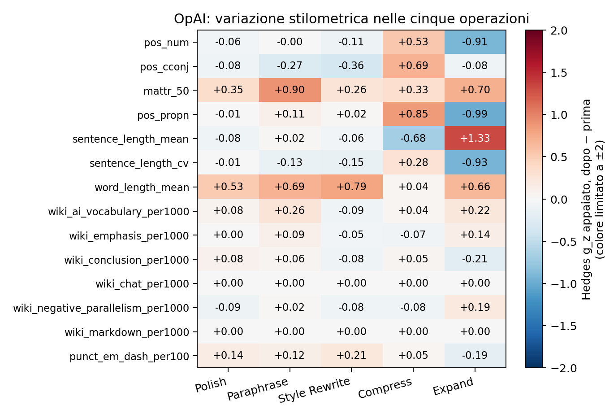
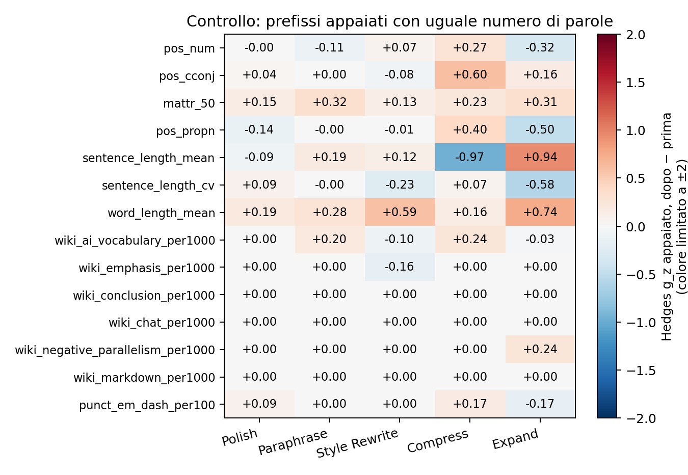

# OpAI-Bench: quali feature cambiano fra versioni adiacenti

200 traiettorie comuni ai cinque stadi, 188 originali distinti, 1000 coppie e 1160 testi unici. Campionamento bilanciato dominio × editor; seed 42.

Le operazioni muovono le feature in modi diversi. Alcuni esempi, senza convertirli in giudizi di naturalezza: Polish: word_length_mean Δ=+0.0132 (IC95% [+0.0095; +0.0169]), g_z=+0.53; Paraphrase: mattr_50 Δ=+0.0079 (IC95% [+0.0067; +0.0093]), g_z=+0.90; Style Rewrite: word_length_mean Δ=+0.1088 (IC95% [+0.0892; +0.1301]), g_z=+0.79; Compress: pos_propn Δ=+0.0044 (IC95% [+0.0037; +0.0052]), g_z=+0.85; Expand: sentence_length_mean Δ=+3.7725 (IC95% [+3.3693; +4.1723]), g_z=+1.33.

| operation | pairs | unique_sources | changed | before_mean_words | after_mean_words | median_word_ratio | prefix_matched_pairs | prefix_sources |
| --- | --- | --- | --- | --- | --- | --- | --- | --- |
| Polish | 200 | 188 | 191 | 426.505 | 425.548 | 1.000 | 122 | 114 |
| Paraphrase | 200 | 188 | 196 | 425.548 | 424.803 | 1.000 | 70 | 67 |
| Style Rewrite | 200 | 188 | 193 | 424.803 | 425.332 | 1.003 | 74 | 74 |
| Compress | 200 | 188 | 197 | 425.332 | 385.936 | 0.910 | 34 | 34 |
| Expand | 200 | 188 | 195 | 385.936 | 457.785 | 1.156 | 36 | 34 |

La differenza è sempre **dopo − prima**. Polish confronta v0 umano con v1 modificato dall’AI; gli altri confronti riguardano versioni già modificate. Le versioni sono cumulative: il confronto adiacente isola meglio lo stadio corrente, ma la sua risposta dipende anche dalla storia precedente. Una variazione delle feature non dimostra maggiore naturalezza né umanizzazione.

## Shortlist della prima fase

| operation | feature | before_mean | after_mean | mean_delta | delta_ci_low | delta_ci_high | paired_hedges_gz | q_bh_all_features_operations |
| --- | --- | --- | --- | --- | --- | --- | --- | --- |
| polish | mattr_50 | 0.800 | 0.801 | 0.002 | 9.74e-04 | 0.002 | 0.350 | 1.86e-05 |
| polish | pos_cconj | 0.036 | 0.036 | -1.17e-04 | -3.39e-04 | 7.66e-05 | -0.082 | 0.409 |
| polish | pos_num | 0.016 | 0.016 | -3.55e-05 | -1.25e-04 | 4.85e-05 | -0.057 | 0.576 |
| polish | pos_propn | 0.071 | 0.071 | -1.25e-05 | -2.58e-04 | 2.44e-04 | -0.007 | 0.965 |
| paraphrase | mattr_50 | 0.801 | 0.809 | 0.008 | 0.007 | 0.009 | 0.900 | 9.97e-25 |
| paraphrase | pos_cconj | 0.036 | 0.035 | -6.36e-04 | -0.001 | -3.18e-04 | -0.270 | 0.001 |
| paraphrase | pos_num | 0.016 | 0.016 | -3.98e-06 | -1.78e-04 | 1.77e-04 | -0.003 | 0.996 |
| paraphrase | pos_propn | 0.071 | 0.071 | 2.66e-04 | -8.73e-05 | 6.33e-04 | 0.105 | 0.275 |
| style | mattr_50 | 0.809 | 0.813 | 0.003 | 0.001 | 0.005 | 0.260 | 0.002 |
| style | pos_cconj | 0.035 | 0.034 | -9.15e-04 | -0.001 | -5.52e-04 | -0.356 | 1.33e-05 |
| style | pos_num | 0.016 | 0.016 | -2.29e-04 | -5.70e-04 | 3.70e-05 | -0.105 | 0.275 |
| style | pos_propn | 0.071 | 0.071 | 1.19e-04 | -6.40e-04 | 0.001 | 0.018 | 0.881 |
| compress | mattr_50 | 0.813 | 0.817 | 0.004 | 0.002 | 0.005 | 0.332 | 5.18e-05 |
| compress | pos_cconj | 0.034 | 0.037 | 0.002 | 0.002 | 0.003 | 0.688 | 2.02e-16 |
| compress | pos_num | 0.016 | 0.017 | 0.001 | 7.52e-04 | 0.001 | 0.535 | 6.22e-11 |
| compress | pos_propn | 0.071 | 0.076 | 0.004 | 0.004 | 0.005 | 0.854 | 7.24e-23 |
| expand | mattr_50 | 0.817 | 0.826 | 0.009 | 0.007 | 0.011 | 0.703 | 6.45e-17 |
| expand | pos_cconj | 0.037 | 0.036 | -4.22e-04 | -0.001 | 3.02e-04 | -0.080 | 0.423 |
| expand | pos_num | 0.017 | 0.015 | -0.002 | -0.003 | -0.002 | -0.907 | 6.25e-25 |
| expand | pos_propn | 0.076 | 0.067 | -0.009 | -0.010 | -0.008 | -0.994 | 2.47e-28 |

## Cinque variazioni standardizzate maggiori per operazione

Si ordinano per |g_z| le feature con q BH <0,05, escludendo soltanto i conteggi globali e TTR/hapax diagnostici. La tabella completa contiene tutte le 105 feature, anche nulle o non significative.

| operation | feature | mean_delta | delta_ci_low | delta_ci_high | paired_hedges_gz | q_bh_all_features_operations |
| --- | --- | --- | --- | --- | --- | --- |
| compress | punct_period_per100 | 0.530 | 0.487 | 0.576 | 1.651 | 5.69e-53 |
| compress | fw_total | -0.018 | -0.021 | -0.016 | -1.145 | 2.42e-34 |
| compress | pos_adp | -0.007 | -0.008 | -0.006 | -0.964 | 3.42e-27 |
| compress | punct_total_per100 | 1.054 | 0.908 | 1.238 | 0.901 | 9.85e-25 |
| compress | pos_propn | 0.004 | 0.004 | 0.005 | 0.854 | 7.24e-23 |
| expand | sentence_length_mean | 3.773 | 3.369 | 4.172 | 1.327 | 2.44e-41 |
| expand | punct_period_per100 | -0.885 | -0.983 | -0.783 | -1.287 | 7.77e-40 |
| expand | flesch_kincaid_grade | 1.862 | 1.645 | 2.067 | 1.247 | 2.57e-38 |
| expand | flesch_reading_ease | -7.073 | -8.034 | -6.127 | -1.028 | 1.04e-29 |
| expand | pos_propn | -0.009 | -0.010 | -0.008 | -0.994 | 2.47e-28 |
| paraphrase | mattr_50 | 0.008 | 0.007 | 0.009 | 0.900 | 9.97e-25 |
| paraphrase | word_length_mean | 0.058 | 0.046 | 0.070 | 0.693 | 1.35e-16 |
| paraphrase | flesch_reading_ease | -1.624 | -1.987 | -1.264 | -0.616 | 9.00e-14 |
| paraphrase | flesch_kincaid_grade | 0.234 | 0.180 | 0.287 | 0.597 | 4.56e-13 |
| paraphrase | syllables_per_word | 0.019 | 0.014 | 0.023 | 0.573 | 3.13e-12 |
| polish | word_length_mean | 0.013 | 0.009 | 0.017 | 0.526 | 1.21e-10 |
| polish | syllables_per_word | 0.005 | 0.003 | 0.006 | 0.507 | 4.67e-10 |
| polish | flesch_reading_ease | -0.344 | -0.456 | -0.235 | -0.447 | 3.76e-08 |
| polish | punct_comma_per100 | 0.162 | 0.108 | 0.220 | 0.410 | 4.65e-07 |
| polish | punct_total_per100 | 0.194 | 0.127 | 0.265 | 0.400 | 8.37e-07 |
| style | syllables_per_word | 0.044 | 0.037 | 0.052 | 0.826 | 9.33e-22 |
| style | word_length_mean | 0.109 | 0.089 | 0.130 | 0.792 | 2.01e-20 |
| style | pos_pron | -0.003 | -0.004 | -0.002 | -0.500 | 8.30e-10 |
| style | punct_comma_per100 | 0.217 | 0.152 | 0.285 | 0.472 | 6.62e-09 |
| style | pos_noun | 0.003 | 0.002 | 0.004 | 0.415 | 3.29e-07 |

## Controllo della lunghezza

Analisi primaria sui documenti interi. Il controllo usa soltanto prefissi iniziali con lo stesso esatto numero di parole lessicali spaCy (90–180, il valore comune più vicino a150), terminati al confine di una frase del parser e con punteggiatura finale. Non si appaiano fonti diverse e non si aggiungono parole. Caratteri e numero di frasi restano liberi.

Nel controllo sono disponibili 336/1000 coppie. Fra le quattro feature della shortlist, le combinazioni con q BH <0,05 sono: Compress/pos_cconj. Una perdita di significatività rispetto al documento intero può dipendere dalla selezione, dalla diversa posizione osservata e dalla minore numerosità; non prova che il risultato iniziale fosse causato dalla sola lunghezza.

Questo controllo cambia la popolazione: seleziona coppie con un confine di frase a conteggio identico e misura passaggi iniziali, non documenti completi. Non è una stima causale dell’effetto della sola lunghezza. Le frequenze normalizzate e MATTR50 riducono la dipendenza dai conteggi, ma possono comunque variare con contenuto, posizione e lunghezza. Vedere `prefix_matched_feature_values.csv` e le righe `exact_prefix_length_matched` di `summary.csv`.

## Inferenza e file

Le feature sono le 105 definizioni fisse di `stylometry/features.py`: spaCy small, textstat, MATTR50 manuale. Prima si mediano le variazioni dei diversi editor dello stesso documento umano. Il documento sorgente è l’unità indipendente: media/mediana, test t appaiato su variazioni per fonte, IC95% bootstrap per fonte (1000 repliche). Hedges g_z = correzione J × media delle differenze / SD delle differenze fra fonti; non coincide con Hedges g pooled della prima fase. Gli IC di g_z ricampionano le stesse fonti. BH corregge insieme tutte le 105 ×5 ipotesi entro ciascuna delle due analisi.

Fonti con feature mancante vengono escluse soltanto per quella feature; `n_sources` e `n_pairs` lo rendono esplicito. Feature con delta sempre zero hanno g_z=0 e p=1; delta costante nonzero ha standardizzazione indefinita. I valori p non stimano la rilevanza pratica e gli IC non includono l’incertezza del parser.

`paired_feature_values.csv`: valori prima/dopo/delta per coppia, senza testi. `document_features.csv`: cache derivata per testo unico. `summary.csv`: tutte le feature nei due protocolli. `stratified_mean_deltas.csv`: medie descrittive per dominio/editor. `data_manifest.json`: selezione e provenienza dei Parquet ufficiali. Tutti i testi restano localmente in `data/opai_style/`, ignorati da Git.

Riproduzione: `.venv/bin/python scripts/run_opai_style.py`; ripresa della cache locale: aggiungere `--reuse-features`.
