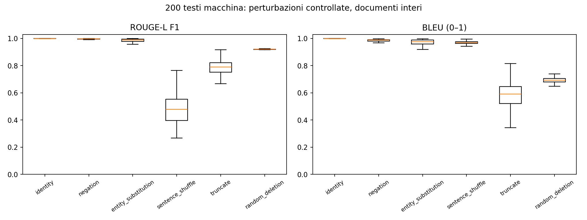
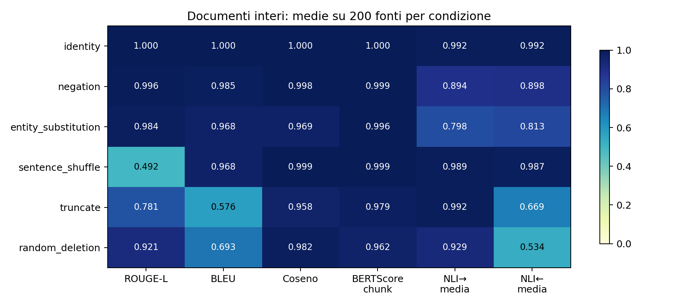
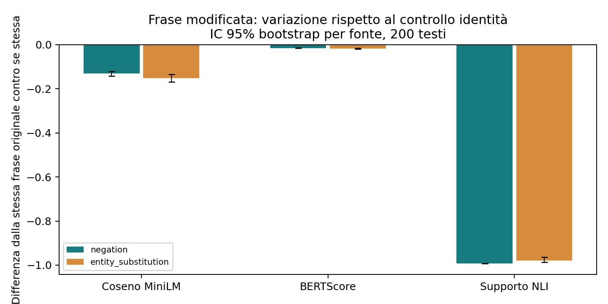

# Validazione semantica estesa: controlli positivi, alterazioni sottili e aggregatori

Testi macchina originali: **200**; seed 42. Campione selezionato tra i testi idonei a tutte le trasformazioni, bilanciando dominio e generatore per quanto consentito dagli idonei. Questa selezione introduce un bias esplicito: le frasi ambigue o senza entità non vengono rappresentate. Le trasformazioni non applicabili sono contate, non sostituite con identità; vedere `eligibility_manifest.json`.

| perturbazione | applicate | saltate |
| --- | --- | --- |
| identity | 200 | 0 |
| negation | 200 | 0 |
| entity_substitution | 200 | 0 |
| sentence_shuffle | 200 | 0 |
| truncate | 200 | 0 |
| random_deletion | 200 | 0 |

## Metriche effettivamente eseguite

| stage | n_pairs | elapsed_seconds | peak_rss_mib |
| --- | --- | --- | --- |
| lexical | 2621 | 57.106 | 240.266 |
| embedding | 2621 | 71.986 | 668.594 |
| bertscore | 2621 | 268.752 | 1531.781 |
| nli | 2621 | 1553.794 | 2049.688 |

| perturbation | metric | n_pairs | mean | ci_low | ci_high |
| --- | --- | --- | --- | --- | --- |
| entity_substitution | lexical_rouge_l_f1 | 200 | 0.984 | 0.982 | 0.986 |
| entity_substitution | lexical_bleu | 200 | 0.968 | 0.963 | 0.972 |
| entity_substitution | embedding_cosine | 200 | 0.969 | 0.959 | 0.977 |
| entity_substitution | bert_chunk_f1 | 200 | 0.996 | 0.996 | 0.997 |
| entity_substitution | nli_forward_mean | 200 | 0.798 | 0.774 | 0.824 |
| entity_substitution | nli_reverse_mean | 200 | 0.813 | 0.790 | 0.836 |
| identity | lexical_rouge_l_f1 | 200 | 1.000 | 1.000 | 1.000 |
| identity | lexical_bleu | 200 | 1.000 | 1.000 | 1.000 |
| identity | embedding_cosine | 200 | 1.000 | 1.000 | 1.000 |
| identity | bert_chunk_f1 | 200 | 1.000 | 1.000 | 1.000 |
| identity | nli_forward_mean | 200 | 0.992 | 0.992 | 0.992 |
| identity | nli_reverse_mean | 200 | 0.992 | 0.992 | 0.992 |
| negation | lexical_rouge_l_f1 | 200 | 0.996 | 0.995 | 0.996 |
| negation | lexical_bleu | 200 | 0.985 | 0.983 | 0.986 |
| negation | embedding_cosine | 200 | 0.998 | 0.997 | 0.998 |
| negation | bert_chunk_f1 | 200 | 0.999 | 0.999 | 0.999 |
| negation | nli_forward_mean | 200 | 0.894 | 0.885 | 0.903 |
| negation | nli_reverse_mean | 200 | 0.898 | 0.889 | 0.907 |
| random_deletion | lexical_rouge_l_f1 | 200 | 0.921 | 0.921 | 0.921 |
| random_deletion | lexical_bleu | 200 | 0.693 | 0.691 | 0.696 |
| random_deletion | embedding_cosine | 200 | 0.982 | 0.980 | 0.983 |
| random_deletion | bert_chunk_f1 | 200 | 0.962 | 0.962 | 0.963 |
| random_deletion | nli_forward_mean | 200 | 0.929 | 0.921 | 0.938 |
| random_deletion | nli_reverse_mean | 200 | 0.534 | 0.515 | 0.554 |
| sentence_shuffle | lexical_rouge_l_f1 | 200 | 0.492 | 0.475 | 0.510 |
| sentence_shuffle | lexical_bleu | 200 | 0.968 | 0.965 | 0.969 |
| sentence_shuffle | embedding_cosine | 200 | 0.999 | 0.999 | 1.000 |
| sentence_shuffle | bert_chunk_f1 | 200 | 0.999 | 0.998 | 0.999 |
| sentence_shuffle | nli_forward_mean | 200 | 0.989 | 0.987 | 0.991 |
| sentence_shuffle | nli_reverse_mean | 200 | 0.987 | 0.982 | 0.990 |
| truncate | lexical_rouge_l_f1 | 200 | 0.781 | 0.770 | 0.789 |
| truncate | lexical_bleu | 200 | 0.576 | 0.560 | 0.591 |
| truncate | embedding_cosine | 200 | 0.958 | 0.951 | 0.963 |
| truncate | bert_chunk_f1 | 200 | 0.979 | 0.978 | 0.980 |
| truncate | nli_forward_mean | 200 | 0.992 | 0.992 | 0.992 |
| truncate | nli_reverse_mean | 200 | 0.669 | 0.660 | 0.679 |

Gli IC 95% ricampionano i documenti sorgente (1.000 bootstrap), assegnando uguale peso a ciascuna fonte. Non descrivono l’incertezza della correttezza semantica delle perturbazioni. `paired_identity_deltas.csv` confronta ogni trasformazione con l’identità della stessa sorgente; i confronti locali usano l’esatta frase target contro se stessa.

## Confronto delle metriche neurali e sfide locali

| dataset | perturbation | local_bert_f1 | local_embedding_cosine | local_nli_forward_contradiction_mean | local_nli_forward_mean | local_nli_forward_neutral_mean |
| --- | --- | --- | --- | --- | --- | --- |
| controlled | entity_substitution | 0.982 | 0.848 | 0.837 | 0.014 | 0.149 |
| controlled | negation | 0.984 | 0.869 | 0.998 | 0.001 | 0.001 |
| local_control | identity_for_entity_substitution | 1.000 | 1.000 | 0.001 | 0.992 | 0.007 |
| local_control | identity_for_negation | 1.000 | 1.000 | 9.82e-04 | 0.994 | 0.005 |

Le probabilità NLI locali riguardano soltanto la frase modificata. Una variazione grande locale può diluirsi nella media di un documento lungo. Le scale dei modelli sono diverse: BERTScore non riscalato può essere numericamente alto anche per frasi non correlate. Usare le differenze rispetto al controllo identità della stessa frase, senza soglie universali.

## OpAI-Bench: asimmetria e verifica delle trasformazioni

Nessuna coppia ufficiale OpAI disponibile.

Forward−reverse positivo è nella direzione attesa per una compressione che perde informazione; negativo per un’espansione che ne aggiunge. I casi immutati o con direzione di lunghezza diversa da quella nominale restano nel campione principale e sono contati. Il confronto v0 è cumulativo e comprende tutte le modifiche precedenti. Gli IC ricampionano il documento umano sorgente, raggruppando i suoi editor.

## Copertura dell’esecuzione

Tutti e quattro gli stadi sono stati eseguiti su tutte le coppie preparate.

**Campione OpAI-Bench preparato:** {"status": "prepared", "n_pairs": 862, "n_positive_pairs": 300, "n_matched_negatives": 562}

Gli stadi disponibili sono stati eseguiti con i checkpoint reali; nessun valore è stato riempito sulla base del risultato atteso.

## Definizioni e interpretazione

- ROUGE-L F1 usa stemming Porter; BLEU è SacreBLEU 13a, smoothing esponenziale, use_effective_order=True, una reference, scala 0–1. Le versioni locali sono sulle frasi effettivamente modificate.
- Coseno: medie normalizzate e pesate per token delle rappresentazioni di frasi/chunk MiniLM, senza troncamento del documento.
- BERTScore locale: RoBERTa-base layer10, IDF=False, rescale_with_baseline=False. Per documenti lunghi si usa una distinta approssimazione con matching di chunk, non il BERTScore integrale troncato.
- NLI: DeBERTa-v3-base addestrato su MNLI/FEVER/ANLI. Forward significa originale→modificato; reverse modificato→originale. La mappa delle etichette viene letta dal config. Le probabilità non sono una prova logica.
- Per ogni frase/chunk ipotesi si recuperano fino a 3 candidati e si conserva il supporto massimo. Si riportano media, minimo, q10, quota sotto 0.5 e contraddizione; il massimo può sovrastimare il supporto e il retrieval può perdere evidenza distribuita. I target locali evitano retrieval e diluizione.
- Negazione: alterazione intenzionale, non gold contradiction verificata per tutti i casi. Entity swap: contenuto alterato o non supportato, non necessariamente contraddittorio. Troncamento e omissione: spesso neutralità nella direzione che richiede informazione persa.
- Shuffle conserva le proposizioni: un NLI aggregato per frase può legittimamente restare alto. Questo test segnala il limite rispetto a coerenza e ordine narrativo.
- Le versioni OpAI sono cumulative: confronti principali v3→v4 Compress e v4→v5 Expand; v0→v4/v5 sono secondari. Le espansioni senza nuove informazioni possono essere entailed in entrambe le direzioni.

## Ripresa

Comandi e versioni sono nel README e in SEMANTIC_EXPERIMENT.md. Ogni stadio gira in un processo separato; la tabella degli stadi riporta il massimo RSS effettivamente osservato, non una stima della sola dimensione dei pesi. La cache delle rappresentazioni token BERT viene limitata a 512MiB tra documenti.

File completi: `scores.csv`, `metric_summary.csv`, `directional_deltas.csv`, `preparation_manifest.json`, `*_run.json`. I testi delle coppie e i metadati esatti delle modifiche restano nella directory dati locale indicata dai comandi di esecuzione (`data/semantic_full/` per il run completo), ignorata da Git.
