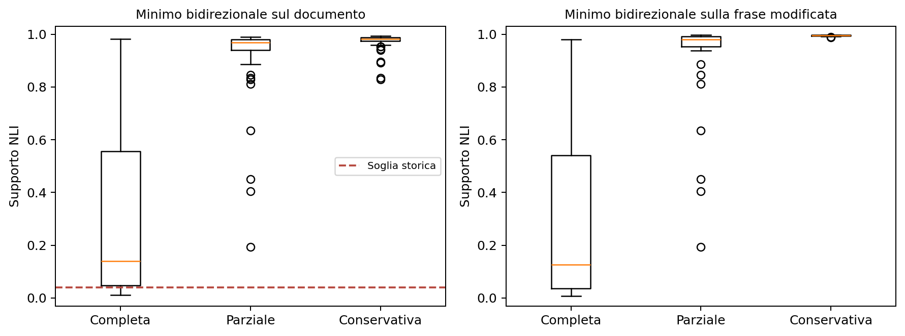

# Cautele epistemiche: test mirato con soglia storica fissa

**Data dell'analisi: 12/11/2026.**

## Obiettivo e risposta del test

Il pannello comprende **120 modifiche con intento di alterazione** (60 rimozioni complete e 60 rafforzamenti parziali), **60 parafrasi con intento conservativo** e **60 originali distinti**. Si valuta soltanto la risposta dell'NLI alle cautele: non si ripetono gli altri esperimenti semantici e non si valuta direttamente la humanization.

Le etichette indicano l'intento delle regole, controllato mediante lettura dell'assistente prima dei punteggi. Non sono disponibili etichette umane indipendenti per questo nuovo pannello. I casi linguisticamente ambigui sono segnalati e analizzati separatamente.

Sul confronto complessivo, l'AUC documentale è **0,856**, la sensibilità alla soglia storica è **10,8%** e i falsi allarmi sui controlli conservativi sono **0,0%**. La soglia è mantenuta, non ricalibrata. Il confronto con i due tipi di trasformazione e con i controlli positivi è necessario per interpretare questi valori.

Nel sottoinsieme con alterazioni e controlli entrambi chiaramente validi alla lettura dell'assistente rimangono **25 originali, 49 alterazioni e 25 controlli**: AUC **0,844**, IC 95% **[0,794; 0,902]**, sensibilità **16,0%**, falsi allarmi **0,0%**. Anche questo sottoinsieme resta privo di etichette umane indipendenti.

## Che cosa viene modificato

Ogni originale mantiene tre confronti collegati quando applicabili: una rimozione della cautela, un rafforzamento parziale che mantiene una qualificazione e una parafrasi che conserva l'incertezza. L'intento delle trasformazioni non è di per sé una gold label: avverbi e modali possono avere funzioni differenti, essere ridondanti o modificare proposizioni diverse. Il tipo di errore deve quindi essere letto nel contesto.

Un esempio effettivo del pannello chiarisce la distinzione. L'originale dice: “Memes themselves **may be** byproducts of other evolved features rather than adaptations”. La rimozione sostituisce “may be” con “are”; il rafforzamento parziale usa “are probably”; il controllo fedele diventa “It is possible that memes themselves are byproducts of other evolved features rather than adaptations”. Il primo passaggio afferma ciò che prima era soltanto possibile, il secondo lo rende probabile, il terzo conserva la possibilità. Non si sta decidendo se l'affermazione sui memi sia vera: si confronta la forza delle affermazioni.

I controlli conservativi provengono dagli stessi originali delle alterazioni. Non si confrontano semplicemente identità facili con testi modificati, né si confonde la classe con la provenienza da un altro corpus. Il numero di coppie è distinto dal numero di originali indipendenti; le varianti dello stesso testo rimangono insieme nell'analisi.

## Provenienza e selezione dei testi

Si usano testi macchina nativi dei tre file MGTBench del progetto, lunghi da 80 a 1.000 parole prima della modifica. La cautela è già presente nell'originale: non viene inserita artificialmente. Si seleziona un solo testo macchina per gruppo di fonte, collegando righe con prompt o testo umano condiviso e rimuovendo duplicati. Gruppo e testo macchina non sono sinonimi: lo stesso gruppo può contenere generazioni differenti.

| Dominio | Originali indipendenti |
| --- | --- |
| Essay | 22 |
| Reuters | 16 |
| WritingPrompts | 22 |

Il piano iniziale preferiva 20 originali per dominio. Lo screening non ha trovato abbastanza Reuters ammissibili; prima di qualsiasi inferenza NLI è stata accettata una distribuzione non uniforme, mantenendo 60 originali e senza allentare le regole semantiche. Sono stati riammessi testi usati soltanto per la stilometria: non avevano contribuito alla calibrazione NLI. Restano esclusi i casi delle precedenti perturbazioni semantiche indicati nel protocollo. Le modifiche del piano e gli screening falliti sono documentati, non nascosti.

Il criterio storico era calibrato su OpAI, mentre qui si usano testi MGTBench. Si verifica quindi anche un trasferimento fra distribuzioni: il risultato non isola soltanto l'effetto di ampliare il numero di esempi della vecchia categoria. I controlli conservativi e le alterazioni condividono però le stesse fonti nel nuovo test.

L'audit delle sovrapposizioni è in `source_overlap_audit.json`: cinque gruppi sono condivisi con lo study Kaggle da 126 fonti, ma con generatori differenti e nessuna coincidenza dell'originale macchina confrontato. Non si presenta dunque il pannello come un insieme di gruppi mai incontrati in tutto il progetto. Gli originali della calibrazione NLI OpAI non coincidono testualmente con quelli del nuovo test.

## Configurazione e soglia

spaCy con `en_core_web_sm` identifica le frasi e le costruzioni ammissibili. `all-MiniLM-L6-v2` recupera, per ogni unità, le tre premesse più simili nell'altro testo. Le unità lunghe sono suddivise in blocchi entro 160 token per il recupero; ogni coppia NLI rispetta il budget di 384 token. **DeBERTa-v3 base**, checkpoint `MoritzLaurer/DeBERTa-v3-base-mnli-fever-anli`, calcola entailment nelle due direzioni in float32. Si riutilizzano modelli locali e l'export ONNX già disponibile; non viene addestrato alcun modello.

Forward significa originale come premessa e riscrittura come ipotesi; reverse scambia i ruoli. Per ogni unità si prende il massimo entailment tra le tre premesse recuperate, poi il minimo sulle unità. Questa è la configurazione storica della soglia, distinta dalla configurazione contestuale `window2` della suite attuale.

Il punteggio documentale è **il minimo fra supporto forward e reverse**, con le rispettive unità e regole storiche. La decisione è: **segnalare se il supporto è inferiore a 0.040749866515398**, visualizzato come 0,04075. Non si sceglie una soglia guardando il nuovo test e non la si trasferisce a una configurazione NLI diversa.

L'AUC usa il punteggio continuo orientato come rischio di alterazione, cioè meno supporto significa più rischio. È indipendente dalla soglia; sensibilità e falsi allarmi riguardano invece il punto operativo fissato. Non si inverte il segno se un'AUC è inferiore a 0,5.

In termini pratici, **AUC 0,5** indica un ordinamento equivalente al caso e **AUC 1** una separazione perfetta; non è una percentuale di testi classificati correttamente. La **sensibilità** è la quota delle modifiche intenzionalmente alteranti che produce un allarme. Il **tasso di falsi positivi (FPR)** è la quota delle parafrasi conservative segnalata come problematica. La specificità è uno meno questo tasso. Sensibilità e falsi allarmi devono essere letti insieme.

Rafforzare un'affermazione cauta può produrre un mancato supporto senza contraddizione: da “P potrebbe essere vero” non segue “P è vero”, mentre le due affermazioni possono essere compatibili. Per questo si conservano anche i punteggi delle due direzioni e della frase modificata.

## Risultati sul pannello completo

| Confronto | Alterati / controlli | AUC | IC 95% AUC | Sensibilità | IC sensibilità (%) | Falsi allarmi |
| --- | --- | --- | --- | --- | --- | --- |
| Tutte le alterazioni | 120/60 | 0,856 | [0,819; 0,891] | 10,8% | [5,8; 15,8] | 0,0% |
| Rimozione completa | 60/60 | 0,978 | [0,949; 0,997] | 21,7% | [11,7; 31,7] | 0,0% |
| Rafforzamento parziale | 60/60 | 0,733 | [0,667; 0,800] | 0,0% | [0,0; 0,0] | 0,0% |

| Confronto | Allarmi alterati | Allarmi conservativi | FPR per fonte | IC FPR (%) | Specificità |
| --- | --- | --- | --- | --- | --- |
| Tutte le alterazioni | 13/120 | 0/60 | 0,0% | [0,0; 0,0] | 100,0% |
| Rimozione completa | 13/60 | 0/60 | 0,0% | [0,0; 0,0] | 100,0% |
| Rafforzamento parziale | 0/60 | 0/60 | 0,0% | [0,0; 0,0] | 100,0% |

Ogni originale ha uguale peso entro ciascuna classe. La sensibilità per fonte può quindi differire dal semplice rapporto degli allarmi. I conteggi grezzi sono riportati esplicitamente. Nel confronto rimozione completa o parziale vengono usati soltanto i controlli conservativi collegati agli stessi originali.

Gli intervalli al 95% sono ottenuti con **2000 bootstrap per originale**: tutte le varianti di una fonte viaggiano insieme. Sono intervalli puntuali, condizionati a testi, regole e modelli fissati; non rappresentano tutta l'incertezza di selezione del campione o l'affidabilità generale sui veri humanizer. Non viene ricalibrata alcuna soglia nei ricampionamenti.

Se una quota osservata è zero o uno, il bootstrap empirico può produrre un intervallo degenere: questo non dimostra che il corrispondente tasso nella popolazione sia esattamente zero o uno.

Anche un'AUC empirica di 1 può avere un bootstrap interamente pari a 1 se i casi osservati sono perfettamente separati. Questo descrive il campione e non dimostra una separazione perfetta su nuovi testi, soprattutto nei sottoinsiemi piccoli.

Come controllo secondario si riportano intervalli di Wilson soltanto quando ogni originale contribuisce un unico esempio nella classe considerata, assumendo indipendenza fra originali. Questo vale per ciascun sottotipo e per i controlli conservativi. Non si applica Wilson alla sensibilità complessiva con due alterazioni dello stesso originale, né all'AUC. Il bootstrap per fonte rimane il metodo principale.

| Confronto | Wilson 95% sensibilità (%) | Wilson 95% falsi allarmi (%) |
| --- | --- | --- |
| Tutte le alterazioni | non applicabile: più varianti per fonte | [0,0; 6,0] |
| Rimozione completa | [13,1; 33,6] | [0,0; 6,0] |
| Rafforzamento parziale | [0,0; 6,0] | [0,0; 6,0] |

## Frase modificata e aggregazione documentale

| Confronto locale | AUC | IC 95% | Originali |
| --- | --- | --- | --- |
| Tutte le alterazioni | 0,970 | [0,948; 0,987] | 60 |
| Rimozione completa | 1,000 | [1,000; 1,000] | 60 |
| Rafforzamento parziale | 0,940 | [0,897; 0,974] | 60 |

La soglia storica documentale **non è applicata al punteggio locale**. La sua AUC è una diagnostica della capacità di riconoscere il cambiamento nella frase interessata. Un minimo documentale può invece essere determinato da una frase difficile diversa da quella modificata; non va interpretato come percentuale di significato conservato.

I riepiloghi forward/reverse, supporto e contraddizione sono in `directional_summary.csv`. Un aumento della contraddizione non è un requisito per riconoscere un rafforzamento epistemico.

## Revisione testuale e provenienza delle etichette

| Provenienza revisione | Giudizio | Coppie |
| --- | --- | --- |
| assistant | qualified | 90 |
| assistant | valid | 90 |

Una revisione dell'assistente non è annotazione umana indipendente. Le classi del pannello completo rimangono etichette di intento; i sottoinsiemi revisionati sono analisi secondarie, non nuove etichette umane.

| Condizione | Qualificati | Chiaramente validi |
| --- | --- | --- |
| Rimozione completa | 29 | 31 |
| Rafforzamento parziale | 28 | 32 |
| Parafrasi conservativa | 33 | 27 |

“Qualificato” indica un dubbio concreto sul valore epistemico, sul tempo narrativo, sulla portata della cautela o sulla ridondanza rispetto al contesto; non è sinonimo di significato certamente alterato. Nel pannello finale 90 coppie sono chiaramente valide e 90 qualificate. Le 4 triplette con errori evidenti sono state sostituite prima delle inferenze, conservando originali e motivazioni in `pre_review/` e `replacements.csv`. Non è stata effettuata alcuna selezione in base agli score.

| Sottoinsieme | Confronto | Originali | AUC | Sensibilità |
| --- | --- | --- | --- | --- |
| Assistente: validi | Tutte le alterazioni | 25 | 0,844 | 16,0% |
| Assistente: validi | Rimozione completa | 24 | 1,000 | 33,3% |
| Assistente: validi | Rafforzamento parziale | 25 | 0,691 | 0,0% |
| Assistente: validi e qualificati | Tutte le alterazioni | 60 | 0,856 | 10,8% |
| Assistente: validi e qualificati | Rimozione completa | 60 | 0,978 | 21,7% |
| Assistente: validi e qualificati | Rafforzamento parziale | 60 | 0,733 | 0,0% |

I sottoinsiemi richiedono controlli conservativi e alterazioni entrambi revisionati e collegati agli stessi originali. Le coppie non revisionate non sono considerate automaticamente valide. I casi qualificati rimangono distinti dai casi chiaramente validi; il pannello completo non viene ripulito sulla base degli score NLI.

## Interpretazione e limiti

Il risultato principale è una distinzione fra **riconoscere una differenza nel punteggio** e **produrre un allarme con la soglia già fissata**. La rimozione completa ha AUC documentale 0,978, IC 95% [0,949; 0,997], ma soltanto 13 casi su 60 scendono sotto 0,04075. Restano quindi non segnalate 47 rimozioni complete su 60. Il rafforzamento parziale ha AUC 0,733, IC [0,667; 0,800], ma nessuno dei 60 casi produce un allarme. L'assenza di falsi allarmi sui 60 controlli non dimostra FPR nullo nella popolazione: il limite superiore Wilson è circa 6,0%.

Il confronto complessivo ha AUC 0,856, IC [0,819; 0,891], e sensibilità 10,8%, IC bootstrap [5,8%; 15,8%]. Questa soglia, pur mantenendo pochi falsi allarmi nel campione, **non offre una copertura adeguata delle modifiche di cautela**, soprattutto di quelle parziali. Non è stata ottimizzata una soglia alternativa su questi dati.

La lettura dei soli casi chiaramente validi non elimina la difficoltà: AUC complessiva 0,844, IC [0,794; 0,902], sensibilità ponderata per originale 16,0%. Nella rimozione completa si segnalano 8/24 casi, mentre nel rafforzamento parziale 0/25. Si tratta comunque di un campione piccolo e revisionato dall'assistente, non da annotatori umani indipendenti.

La diagnostica locale aiuta a spiegare il risultato: l'AUC sulla frase modificata sale a 0,970 complessivamente, 1,000 per la rimozione completa e 0,940 per il rafforzamento parziale. Le mediane del supporto locale sono però rispettivamente 0,126, 0,980 e 0,995 per rimozione, rafforzamento e controllo fedele. Una piccola differenza fra valori entrambi elevati può produrre un buon ordinamento senza avvicinarsi alla soglia di allarme. Il minimo sul documento può inoltre essere determinato da una frase diversa da quella modificata, attenuando la differenza fra versioni. Non si applica la soglia documentale ai punteggi locali.

L'esempio sui memi presentato nei metodi mostra proprio la differenza fra ordinamento e decisione. Il supporto documentale passa da 0,980 nel controllo conservativo a 0,055 nella rimozione completa: la variazione è forte, ma 0,055 rimane sopra 0,04075 e non produce allarme. Il rafforzamento parziale ha invece supporto documentale 0,980; nella frase modificata il supporto è circa 0,993, contro 0,997 nel controllo.

C'è un ulteriore limite: **separare i casi non dimostra un ragionamento corretto sulla modalità**. In 50/60 rimozioni complete, e in 29/31 di quelle giudicate chiaramente valide dall'assistente, il supporto locale forward è maggiore del reverse. Nell'esempio sui memi il modello assegna 0,846 alla direzione da “may be” ad “are”, ma soltanto 0,051 alla direzione opposta. Questo non segue la lettura logica intuitiva secondo cui una certezza dovrebbe sostenere la corrispondente possibilità più facilmente del contrario. Il confronto tra coppie ordinate, cache e colonne esclude uno scambio delle direzioni nel codice; lo stesso comportamento compare nelle predizioni native. È quindi un limite interpretativo del modello su queste costruzioni. In presenza di cautele, forward e reverse non vanno tradotti automaticamente in “informazione aggiunta” e “informazione persa”.

Per la tesi, la conclusione sostenibile è che **l'NLI contiene un segnale sulle cautele, ma la soglia storica non si trasferisce in questo pannello come rilevatore sensibile di questi cambiamenti**. Non sarebbe corretto affermare né che l'NLI sia del tutto cieco alle cautele, né che una buona AUC equivalga a un controllo automatico già affidabile. Una futura eventuale calibrazione specifica richiederebbe dati di sviluppo separati e un ulteriore test, lasciando questo risultato invariato. Nel frattempo il punteggio continuo e le guardie lessicali sulle variazioni di cautela rimangono indicatori complementari da valutare, senza trasformare l'assenza di allarme in una garanzia di fedeltà.

Il test misura il trasferimento di un criterio già fissato a nuovi esempi di cautela. Una sensibilità alta accompagnata da molti falsi allarmi non dimostra una buona capacità di distinguere cambiamenti reali da parafrasi fedeli. Un'AUC buona con bassa sensibilità alla soglia fissa indica invece che il ranking e la decisione operativa rispondono a domande diverse.

Le regole coprono un sottoinsieme della cautela epistemica: non rappresentano tutte le forme indirette, le citazioni, le condizioni ipotetiche o le differenze di probabilità. Eliminare una parola non equivale necessariamente a eliminare l'incertezza. La revisione testuale e l'eventuale annotazione umana indipendente sono perciò distinte dalle probabilità emesse dal modello.

## Materiali

Sono disponibili [metriche e intervalli](metrics.csv), [punteggi per coppia](pair_scores.csv), [riepiloghi direzionali](directional_summary.csv), [riepilogo](summary.json) e [manifest dell'analisi](analysis_manifest.json). Le AUC dei ricampionamenti sono in `bootstrap_metrics.npz`; eventuali revisioni usate sono conservate separatamente.

`scripts/analyze_hedging_controls.py` ricalcola tabelle, intervalli, figura e questo report senza eseguire nuove inferenze NLI. Il calcolo della soglia storica non viene ripetuto.
